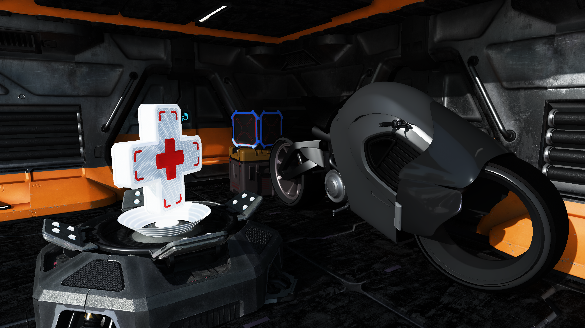
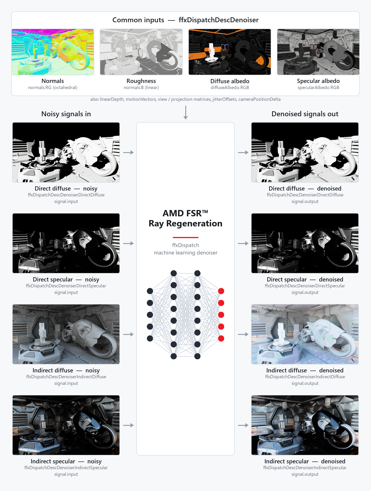
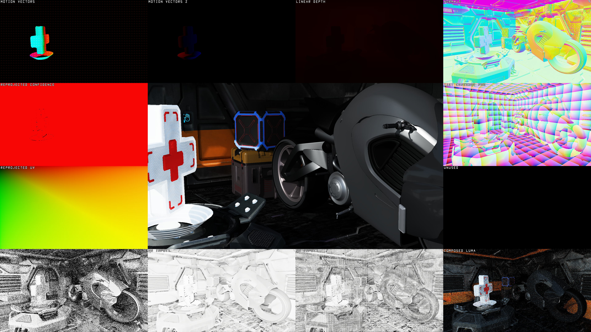
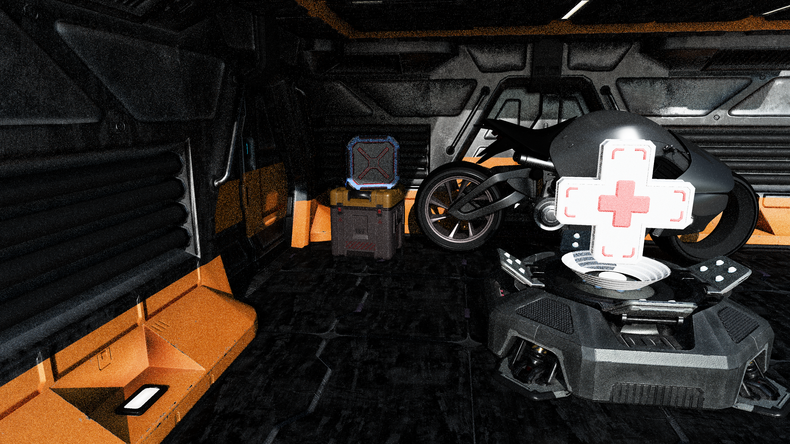
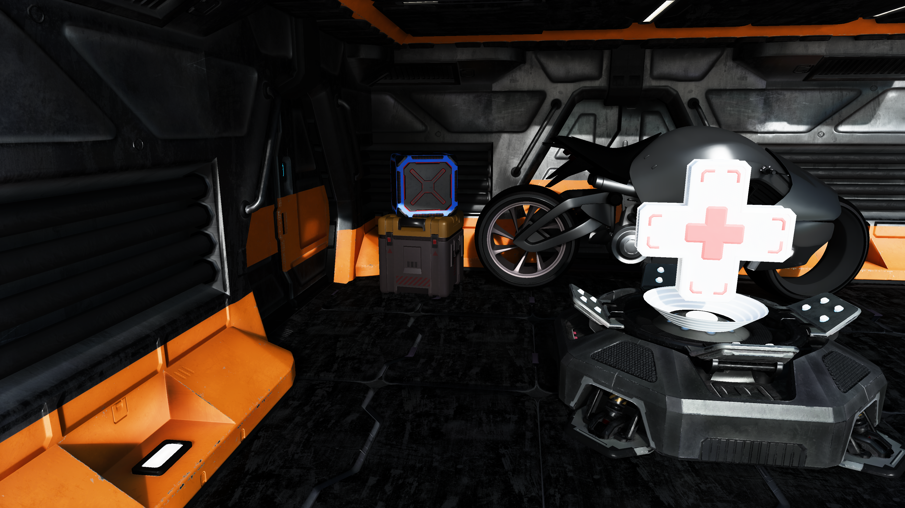

<!-- @page page_techniques_denoising AMD FSR™ Ray Regeneration 1.2.1 Denoiser -->

# AMD FSR™ Ray Regeneration 1.2.1

<p align="center">
  
</p>
<p align="center">
  <b>Figure 1</b>: <i>Sample output from AMD FSR™ Ray Regeneration.</i>
</p>

AMD FSR™ Ray Regeneration is a machine learning-based denoiser for ray-traced workloads.
It improves visual quality by reducing noise in rendered frames while preserving detail.

## Table of contents

- [1. Introduction](#1-introduction)
  - [1.1. Decoupled denoising vs. joint denoising](#11-decoupled-denoising-vs-joint-denoising)
  - [1.2. Signals](#12-signals)
- [2. Getting started](#2-getting-started)
  - [2.1. Setting up your project](#21-setting-up-your-project)
  - [2.2. Setting up logging](#22-setting-up-logging)
  - [2.3. Querying support](#23-querying-support)
  - [2.4. Creating the context](#24-creating-the-context)
    - [2.4.1. `ffxCreateContextDescDenoiser`](#241-ffxcreatecontextdescdenoiser)
    - [2.4.2. `FfxApiCreateContextDenoiserFlags`](#242-ffxapicreatecontextdenoiserflags)
  - [2.5. Dispatching](#25-dispatching)
    - [2.5.1. Checkerboard reconstruction](#251-checkerboard-reconstruction)
    - [2.5.2. `ffxDispatchDescDenoiser`](#252-ffxdispatchdescdenoiser)
    - [2.5.3. `FfxApiDispatchDenoiserFlags`](#253-ffxapidispatchdenoiserflags)
    - [2.5.4. `FfxApiDenoiserSignal`](#254-ffxapidenoisersignal)
    - [2.5.5. `ffxDispatchDescDenoiserAmbientOcclusion`](#255-ffxdispatchdescdenoiserambientocclusion)
    - [2.5.6. `ffxDispatchDescDenoiserDirectDiffuse`](#256-ffxdispatchdescdenoiserdirectdiffuse)
    - [2.5.7. `ffxDispatchDescDenoiserDirectSpecular`](#257-ffxdispatchdescdenoiserdirectspecular)
    - [2.5.8. `ffxDispatchDescDenoiserDominantLight`](#258-ffxdispatchdescdenoiserdominantlight)
    - [2.5.9. `ffxDispatchDescDenoiserIndirectDiffuse`](#259-ffxdispatchdescdenoiserindirectdiffuse)
    - [2.5.10. `ffxDispatchDescDenoiserIndirectSpecular`](#2510-ffxdispatchdescdenoiserindirectspecular)
    - [2.5.11. `ffxDispatchDescDenoiserSpecularOcclusion`](#2511-ffxdispatchdescdenoiserspecularocclusion)
  - [2.6. Configuring settings](#26-configuring-settings)
    - [2.6.1. `ffxConfigureDescDenoiserKeyValue`](#261-ffxconfiguredescdenoiserkeyvalue)
    - [2.6.2. `ffxQueryDescDenoiserGetDefaultKeyValue`](#262-ffxquerydescdenoisergetdefaultkeyvalue)
    - [2.6.3. `FfxApiConfigureDenoiserKey`](#263-ffxapiconfiguredenoiserkey)
  - [2.7. Cleaning up](#27-cleaning-up)
- [3. Performance](#3-performance)
  - [3.1. Timings](#31-timings)
    - [3.1.1. Denoising direct diffuse, direct specular, indirect diffuse and indirect specular signals](#311-denoising-direct-diffuse-direct-specular-indirect-diffuse-and-indirect-specular-signals)
    - [3.1.2. Denoising indirect diffuse and indirect specular signals](#312-denoising-indirect-diffuse-and-indirect-specular-signals)
    - [3.1.3. Denoising indirect specular signal](#313-denoising-indirect-specular-signal)
    - [3.1.4. Denoising dominant light visibility signal](#314-denoising-dominant-light-visibility-signal)
  - [3.2. Memory requirements](#32-memory-requirements)
    - [3.2.1. Denoising direct diffuse, direct specular, indirect diffuse and indirect specular signals](#321-denoising-direct-diffuse-direct-specular-indirect-diffuse-and-indirect-specular-signals)
    - [3.2.2. Denoising indirect diffuse and indirect specular signals](#322-denoising-indirect-diffuse-and-indirect-specular-signals)
    - [3.2.3. Denoising indirect specular signal](#323-denoising-indirect-specular-signal)
    - [3.2.4. Denoising ambient occlusion or dominant light visibility or specular occlusion signal](#324-denoising-ambient-occlusion-or-dominant-light-visibility-or-specular-occlusion-signal)
    - [3.2.5. `ffxQueryDescDenoiserGetGPUMemoryUsage`](#325-ffxquerydescdenoisergetgpumemoryusage)
- [4. Debugging](#4-debugging)
  - [4.1. Debug view](#41-debug-view)
    - [4.1.1. `ffxDispatchDescDenoiserDebugView`](#411-ffxdispatchdescdenoiserdebugview)
- [5. Best practices](#5-best-practices)
  - [5.1. Generating noisy signals](#51-generating-noisy-signals)
    - [5.1.1. Radiance inputs and albedo modulation](#511-radiance-inputs-and-albedo-modulation)
    - [5.1.2. Stochastic sampling](#512-stochastic-sampling)
    - [5.1.3. Noise](#513-noise)
    - [5.1.4. Usage of radiance caching](#514-usage-of-radiance-caching)
    - [5.1.5. Tweakable denoiser settings](#515-tweakable-denoiser-settings)
  - [5.2. Providing motion vectors](#52-providing-motion-vectors)
    - [5.2.1. Space](#521-space)
    - [5.2.2. Coverage](#522-coverage)
  - [5.3. Encoding normals](#53-encoding-normals)
    - [5.3.1. Octahedral encoding of normals:](#531-octahedral-encoding-of-normals)
    - [5.3.2. Octahedral decoding of normals:](#532-octahedral-decoding-of-normals)
  - [5.4. Encoding material type](#54-encoding-material-type)
  - [5.5. Generating specular albedo](#55-generating-specular-albedo)
    - [5.5.1. Example: BRDF lookup table](#551-example-brdf-lookup-table)
    - [5.5.2. Example: BRDF Approximation](#552-example-brdf-approximation)
- [6. Requirements](#6-requirements)
- [7. Version history](#7-version-history)
- [8. See also](#8-see-also)

## 1. Introduction

Since the advent of hardware-accelerated ray tracing, real-time game and rendering engines have increasingly adopted ray tracing techniques.
From realistic reflections to finely detailed shadows, ray tracing has significantly elevated visual fidelity in modern games.
As GPU ray tracing capabilities continue to improve, developers are pushing the boundaries of global illumination and exploring real-time path tracing.
However, raw ray-traced outputs are inherently noisy, making effective denoising essential for producing clean, high-quality images.

Denoising transforms noisy ray- or path-traced outputs into coherent, visually accurate images, often leveraging both spatial and temporal information.
AMD FSR™ Ray Regeneration performs this task with a key advantage: it uses machine learning to dynamically determine optimal filter weights, delivering superior results compared to purely analytical methods.

### 1.1. Decoupled denoising vs. joint denoising

AMD FSR™ Ray Regeneration performs denoising independently of upscaling, making it a decoupled denoiser.
In contrast, denoising and upscaling can also be combined into a single, joint operation.
Both approaches are valid, but decoupling denoising into its own dispatch call simplifies adding additional rendered content afterward.

Although upscaling is not strictly required for denoising, rendering expensive ray-traced effects, especially path tracing, at native resolution can be very demanding on hardware.
With significant advancements in upscaling technology, incorporating upscaling into the rendering pipeline is strongly recommended.
Additionally, the temporal anti-aliasing provided by upscalers such as AMD FSR™ 4 adds an extra layer of smoothing when used alongside AMD FSR™ Ray Regeneration.
For optimal visual results, AMD FSR™ Ray Regeneration should be paired with AMD FSR™ 4.

> [!NOTE]
> AMD FSR™ Ray Regeneration is a standalone denoiser and does **not** perform temporal anti-aliasing or jitter resolution.
> If your application uses camera jitter (e.g. for TAA or upscaler integration), jitter resolution must be handled by a separate upscaler such as AMD FSR™ Upscaling, applied after denoising.

### 1.2. Signals

To maximize compatibility and efficiency when denoising your game's specific workloads, AMD FSR™ Ray Regeneration provides multiple input/output signals:

| Signal flags                                                                                   | Input/output signals:                                   |
|------------------------------------------------------------------------------------------------|---------------------------------------------------------|
| [`FFX_DENOISER_SIGNAL_AMBIENT_OCCLUSION`](../../denoisers/include/ffx_denoiser.h#L599)         | Ambient occlusion (in `[0, 1]`/`[0, 1]`)                |
| [`FFX_DENOISER_SIGNAL_DIRECT_DIFFUSE`](../../denoisers/include/ffx_denoiser.h#L601)            | Direct diffuse                                          |
| [`FFX_DENOISER_SIGNAL_DIRECT_SPECULAR`](../../denoisers/include/ffx_denoiser.h#L603)           | Direct specular                                         |
| [`FFX_DENOISER_SIGNAL_DOMINANT_LIGHT_VISIBILITY`](../../denoisers/include/ffx_denoiser.h#L605) | Dominant light visibility (in `[0, FP16_MAX]`/`[0, 1]`) |
| [`FFX_DENOISER_SIGNAL_INDIRECT_DIFFUSE`](../../denoisers/include/ffx_denoiser.h#L607)          | Indirect diffuse                                        |
| [`FFX_DENOISER_SIGNAL_INDIRECT_SPECULAR`](../../denoisers/include/ffx_denoiser.h#L609)         | Indirect specular                                       |
| [`FFX_DENOISER_SIGNAL_SPECULAR_OCCLUSION`](../../denoisers/include/ffx_denoiser.h#L611)        | Specular occlusion (in `[0, 1]`/`[0, 1]`)               |

The selected signals are specified via the [`signalFlags`](../../denoisers/include/ffx_denoiser.h#L96) member of the [`ffxCreateContextDescDenoiser`](../../denoisers/include/ffx_denoiser.h#L82) context creation description.

## 2. Getting started

### 2.1. Setting up your project

AMD FSR™ Ray Regeneration is part of the AMD FSR™ SDK.
Before getting started, make sure to read the [Getting Started with the AMD FSR™ API](../getting-started/ffx-api.md) guide.
Once familiar with the API, follow these steps to prepare your project for AMD FSR™ Ray Regeneration:

1. Add the [AMD FSR™ API include headers](../../api/include/) to your project's include directories.
2. Add the [AMD FSR™ Ray Regeneration include headers](../../denoisers/include/) to your project's include directories.
3. Link your project against `amd_fidelityfx_loader_dx12.lib`, located in [FidelityFX/signedbin](../../signedbin).
4. Copy `amd_fidelityfx_loader_dx12.dll` and `amd_fidelityfx_denoiser_dx12.dll` from [FidelityFX/signedbin](../../signedbin) into your project's executable directory.

### 2.2. Setting up logging

By default, all messages ([`FFX_API_CONFIGURE_GLOBALDEBUG_LEVEL_VERBOSE`](../../api/include/ffx_api.h#L69)) are output as debug strings.
Logging can be explicitly set up before (or after) context creation for the denoiser effect by passing a [`ffxConfigureDescGlobalDebug`](../../api/include/ffx_api.h#L81) configure description to [`ffxConfigure`](../../api/include/ffx_api.h#L146).

```cpp
// Example: configuring the logging callback for the denoiser effect.
ffx::ConfigureDescGlobalDebug configureDesc = {};
configureDesc.effectId  = FFX_API_EFFECT_ID_DENOISER;
// If set to nullptr, messages will be output as debug strings.
configureDesc.fpMessage = [](uint32_t type, const wchar_t* message)
{
    switch (type)
    {

    case FFX_API_MESSAGE_TYPE_ERROR:
    {
        LogError(message);
        break;
    }
    case FFX_API_MESSAGE_TYPE_WARNING:
    {
        LogWarning(message);
        break;
    }
    default:
    {
      break;
    }

    }
};
configureDesc.debugLevel = FFX_API_CONFIGURE_GLOBALDEBUG_LEVEL_VERBOSE;

ffx::ReturnCode result = ffx::Configure(configureDesc);
assert(result == ffx::ReturnCode::Ok);
```

> [!NOTE]
> Logging is configured globally per effect, not locally per context.

### 2.3. Querying support

Before context creation, you can query supported versions by passing a [`ffxQueryDescGetVersions`](../../api/include/ffx_api.h#L90) query description to [`ffxQuery`](../../api/include/ffx_api.h#L152).
If the query returns no contexts, support for AMD FSR™ Ray Regeneration is not available.

```cpp
// Example: querying all supported AMD FSR™ Ray Regeneration versions.
uint64_t supportedVersionCount = 0;
ffx::QueryDescGetVersions queryDesc = {};
queryDesc.createDescType = FFX_API_EFFECT_ID_DENOISER;
queryDesc.device         = GetDevice()->GetImpl()->DX12Device();
queryDesc.outputCount    = &supportedVersionCount;
ffx::ReturnCode result = ffx::Query(queryDesc);
assert(result == ffx::ReturnCode::Ok);

m_DenoiserVersionIds.resize(supportedVersionCount);
m_DenoiserVersionStrings.resize(supportedVersionCount);

queryDesc.versionIds   = m_DenoiserVersionIds.data();
queryDesc.versionNames = m_DenoiserVersionStrings.data();
result = ffx::Query(queryDesc);
assert(result == ffx::ReturnCode::Ok);

m_DenoiserAvailable = not versionIds.empty();
```

### 2.4. Creating the context

To start using AMD FSR™ Ray Regeneration, you need to create a denoiser context by passing a [`ffxCreateContextDescDenoiser`](../../denoisers/include/ffx_denoiser.h#L82) context creation description along with a backend description to [`ffxCreateContext`](../../api/include/ffx_api.h#L134).
The parameters you provide determine the internal resource allocations and pipeline state compilations.
Creating contexts in time-critical paths is not recommended due to their initialization cost.
If the hardware does not support AMD FSR™ Ray Regeneration, [`ffxCreateContext`](../../api/include/ffx_api.h#L134) will return an error and the context pointer will remain unset.

```cpp
// Example: creating a denoiser context with the desired signal flags.
ffx::CreateBackendDX12Desc backendDesc = {};
backendDesc.device = GetDevice()->GetImpl()->DX12Device();

ffx::CreateContextDescDenoiser createDesc = {};
createDesc.version       = FFX_DENOISER_VERSION;
createDesc.maxRenderSize = { resInfo.UpscaleWidth, resInfo.UpscaleHeight };
// Signals
createDesc.signalFlags   = FFX_DENOISER_SIGNAL_NONE;
if (m_EnableDirectDiffuse)
{
    // Flag indicating that direct diffuse needs to be denoised.
    denoiserContextDesc.signalFlags |= FFX_DENOISER_SIGNAL_DIRECT_DIFFUSE;
}
if (m_EnableDirectSpecular)
{
    // Flag indicating that direct specular needs to be denoised.
    denoiserContextDesc.signalFlags |= FFX_DENOISER_SIGNAL_DIRECT_SPECULAR;
}
if (m_EnableIndirectDiffuse)
{
    // Flag indicating that indirect diffuse needs to be denoised.
    denoiserContextDesc.signalFlags |= FFX_DENOISER_SIGNAL_INDIRECT_DIFFUSE;
}
if (m_EnableIndirectSpecular)
{
    // Flag indicating that indirect specular needs to be denoised.
    denoiserContextDesc.signalFlags |= FFX_DENOISER_SIGNAL_INDIRECT_SPECULAR;
}
if (m_EnableDominantLightVisibility)
{
    // Flag indicating that dominant light visibility needs to be denoised.
    denoiserContextDesc.signalFlags |= FFX_DENOISER_SIGNAL_DOMINANT_LIGHT_VISIBILITY;
}
if (m_EnableAmbientOcclusion)
{
    // Flag indicating that ambient occlusion needs to be denoised.
    denoiserContextDesc.signalFlags |= FFX_DENOISER_SIGNAL_AMBIENT_OCCLUSION;
}
if (m_EnableSpecularOcclusion)
{
    // Flag indicating that specular occlusion needs to be denoised.
    denoiserContextDesc.signalFlags |= FFX_DENOISER_SIGNAL_SPECULAR_OCCLUSION;
}
// Checkerboard reconstruction (optional, must be a subset of signalFlags)
createDesc.checkerboardSignalFlags = FFX_DENOISER_SIGNAL_NONE;
// Flags
denoiserContextDesc.flags = {};
if (m_EnableDebugging)
{
    // Flag indicating that debug features may be enabled. Memory usage may increase.
    denoiserContextDesc.flags |= FFX_DENOISER_ENABLE_DEBUGGING;
}
if (m_EnableValidation)
{
    // Flag indicating that exhaustive validation should be enabled. Performance may decrease.
    denoiserContextDesc.flags |= FFX_DENOISER_ENABLE_VALIDATION;
}

// Create the denoiser context
ffx::ReturnCode result = ffx::CreateContext(m_pDenoiserContext, nullptr, createDesc, backendDesc);
assert(result == ffx::ReturnCode::Ok);
```

#### 2.4.1. [`ffxCreateContextDescDenoiser`](../../denoisers/include/ffx_denoiser.h#L82)

| Parameter | Description |
|---|---|
| [`version`](../../denoisers/include/ffx_denoiser.h#L90) | The version of the API the application was built against. Must be set to `FFX_DENOISER_VERSION`. |
| [`maxRenderSize`](../../denoisers/include/ffx_denoiser.h#L93) | Maximum size that rendering will be performed at. |
| [`signalFlags`](../../denoisers/include/ffx_denoiser.h#L96) | Signal flags corresponding to a combination of values from [`FfxApiDenoiserSignalFlags`](../../denoisers/include/ffx_denoiser.h#L595). |
| [`checkerboardSignalFlags`](../../denoisers/include/ffx_denoiser.h#L101) | Signal flags corresponding to a combination of values from [`FfxApiDenoiserSignalFlags`](../../denoisers/include/ffx_denoiser.h#L595) for signals that use checkerboard reconstruction. Must be a subset of `signalFlags`. |
| [`flags`](../../denoisers/include/ffx_denoiser.h#L104) | Create flags corresponding to zero or a combination of values from [`FfxApiCreateContextDenoiserFlags`](../../denoisers/include/ffx_denoiser.h#L554). |

#### 2.4.2. [`FfxApiCreateContextDenoiserFlags`](../../denoisers/include/ffx_denoiser.h#L554)

| Flag | Description |
|---|---|
| [`FFX_DENOISER_ENABLE_DEBUGGING`](../../denoisers/include/ffx_denoiser.h#L557) | Flag indicating that debug features may be enabled. Memory usage may increase. |
| [`FFX_DENOISER_ENABLE_VALIDATION`](../../denoisers/include/ffx_denoiser.h#L559) | Flag indicating that exhaustive validation should be enabled. Performance may decrease. |

For use cases that require a specific version, you can override the implicit default version by passing a [`ffxOverrideVersion`](../../api/include/ffx_api.h#L101) description to [`ffxCreateContext`](../../api/include/ffx_api.h#L134) too.

```cpp
// Example: creating a denoiser context pinned to a specific version.
ffx::CreateContextDescOverrideVersion versionOverride = {};
versionOverride.versionId = m_DenoiserVersionIds[m_SelectedDenoiserVersion];

// Create the denoiser context
ffx::ReturnCode result = ffx::CreateContext(m_pDenoiserContext, nullptr, createDesc, backendDesc, versionOverride);
assert(result == ffx::ReturnCode::Ok);
```

> [!TIP]
> Denoising an ambient occlusion signal works best if an indirect diffuse signal is provided as well.

> [!TIP]
> Denoising a specular occlusion signal works best if an indirect specular signal is provided as well.

> [!TIP]
> A single application can create and drive several denoiser contexts, each denoising its own subset of signals.
> This is useful when the denoised results are consumed at different points in the frame: each context is created with its own `signalFlags` and dispatched independently, so a signal that is needed early (for example, the dominant light visibility used during lighting) can be denoised and consumed before the remaining signals are denoised later in the frame.
> The signal sets of different contexts do not need to be disjoint: for example, two separate ambient occlusion signals can each be denoised by their own dedicated context.
> Contexts are completely isolated from one another state-wise, each maintaining its own temporal history and accumulation, so they neither share nor interfere with each other's state.
> The AMD FSR™ Ray Regeneration sample demonstrates the mechanics of driving a second, dedicated dominant light visibility context, but dispatches both contexts back-to-back; a real integration would instead dispatch each context at the point in the frame where its result is needed.

### 2.5. Dispatching

Denoising is performed on the GPU by passing the below dispatch descriptions to [`ffxDispatch`](../../api/include/ffx_api.h#L157).
Dispatch descriptions can be passed if and only if the corresponding dispatch conditions are met by the context.
Furthermore, the majority of dispatch descriptions are non-optional and must be passed if and only if the corresponding dispatch conditions are met by the context.

| Dispatch Description                                                                      | Dispatch Condition                                                                                         | Optional
|-------------------------------------------------------------------------------------------|------------------------------------------------------------------------------------------------------------|---------
| [`ffxDispatchDescDenoiser`](../../denoisers/include/ffx_denoiser.h#L167)                  | /                                                                                                          | No
| [`ffxDispatchDescDenoiserAmbientOcclusion`](../../denoisers/include/ffx_denoiser.h#L358)  | [`FFX_DENOISER_SIGNAL_AMBIENT_OCCLUSION`](../../denoisers/include/ffx_denoiser.h#L599) must be set         | No
| [`ffxDispatchDescDenoiserDebugView`](../../denoisers/include/ffx_denoiser.h#L330)         | [`FFX_DENOISER_ENABLE_DEBUGGING`](../../denoisers/include/ffx_denoiser.h#L557) must be set                 | Yes
| [`ffxDispatchDescDenoiserDirectDiffuse`](../../denoisers/include/ffx_denoiser.h#L375)     | [`FFX_DENOISER_SIGNAL_DIRECT_DIFFUSE`](../../denoisers/include/ffx_denoiser.h#L601) must be set            | No
| [`ffxDispatchDescDenoiserDirectSpecular`](../../denoisers/include/ffx_denoiser.h#L395)    | [`FFX_DENOISER_SIGNAL_DIRECT_SPECULAR`](../../denoisers/include/ffx_denoiser.h#L603) must be set           | No
| [`ffxDispatchDescDenoiserDominantLight`](../../denoisers/include/ffx_denoiser.h#L415)     | [`FFX_DENOISER_SIGNAL_DOMINANT_LIGHT_VISIBILITY`](../../denoisers/include/ffx_denoiser.h#L605) must be set | No
| [`ffxDispatchDescDenoiserIndirectDiffuse`](../../denoisers/include/ffx_denoiser.h#L442)   | [`FFX_DENOISER_SIGNAL_INDIRECT_DIFFUSE`](../../denoisers/include/ffx_denoiser.h#L607) must be set          | No
| [`ffxDispatchDescDenoiserIndirectSpecular`](../../denoisers/include/ffx_denoiser.h#L462)  | [`FFX_DENOISER_SIGNAL_INDIRECT_SPECULAR`](../../denoisers/include/ffx_denoiser.h#L609) must be set         | No
| [`ffxDispatchDescDenoiserSpecularOcclusion`](../../denoisers/include/ffx_denoiser.h#L482) | [`FFX_DENOISER_SIGNAL_SPECULAR_OCCLUSION`](../../denoisers/include/ffx_denoiser.h#L611) must be set        | No

<p align="center">
  
</p>
<p align="center">
  <b>Figure 2</b>: <i>Inputs and outputs of an example AMD FSR™ Ray Regeneration dispatch for denoising direct diffuse, direct specular, indirect diffuse and indirect specular signals.
  The common input resources of ffxDispatchDescDenoiser are shown above, and the noisy input and denoised output signal resource of each dispatch description on either side.</i>
</p>

AMD FSR™ Ray Regeneration uses a linked-list pattern to pass multiple dispatch descriptions to a single [`ffxDispatch`](../../api/include/ffx_api.h#L157) call.
Each description header contains a `pNext` pointer that chains the next description in sequence.
The [`ffxDispatchDescDenoiser`](../../denoisers/include/ffx_denoiser.h#L167) description is always the head of the chain; all signal and debug-view descriptions are linked after it.

All descriptions passed to a single `ffxDispatch` call must remain alive (i.e., not go out of scope) for the duration of that call.

```cpp
// Example: dispatching all active signals using manual pNext chaining.
// Needs to persist in the ::ffxDispatch scope.
ffx::DispatchDescDenoiser dispatchDesc = {};
// ... assign description members ...

ffxDispatchDescHeader* prevHeader = &dispatchDesc.header;
const auto link = [&prevHeader](auto& desc)
{
    ffxDispatchDescHeader* const nextHeader = &desc.header;
    prevHeader->pNext = nextHeader;
    prevHeader = nextHeader;
};

// Need to persist in the ::ffxDispatch scope.
ffx::DispatchDescDenoiserAmbientOcclusion dispatchDescAmbientOcclusion = {};
if (m_EnableAmbientOcclusion)
{
    // ... assign description members ...

    link(dispatchDescAmbientOcclusion);
}

// Need to persist in the ::ffxDispatch scope.
ffx::DispatchDescDenoiserDirectDiffuse dispatchDescDirectDiffuse = {};
if (m_EnableDirectDiffuse)
{
    // ... assign description members ...

    link(dispatchDescDirectDiffuse);
}

// Need to persist in the ::ffxDispatch scope.
ffx::DispatchDescDenoiserDirectSpecular dispatchDescDirectSpecular = {};
if (m_EnableDirectSpecular)
{
    // ... assign description members ...

    link(dispatchDescDirectSpecular);
}

// Need to persist in the ::ffxDispatch scope.
ffx::DispatchDescDenoiserDominantLight dispatchDescDominantLight = {};
if (m_EnableDominantLightVisibility)
{
    // ... assign description members ...
    
    link(dispatchDescDominantLight);
}

// Need to persist in the ::ffxDispatch scope.
ffx::DispatchDescDenoiserIndirectDiffuse dispatchDescIndirectDiffuse = {};
if (m_EnableIndirectDiffuse)
{
    // ... assign description members ...

    link(dispatchDescIndirectDiffuse);
}

// Need to persist in the ::ffxDispatch scope.
ffx::DispatchDescDenoiserIndirectSpecular dispatchDescIndirectSpecular = {};
if (m_EnableIndirectSpecular)
{
    // ... assign description members ...

    link(dispatchDescIndirectSpecular);
}

// Need to persist in the ::ffxDispatch scope.
ffx::DispatchDescDenoiserSpecularOcclusion dispatchDescSpecularOcclusion = {};
if (m_EnableSpecularOcclusion)
{
    // ... assign description members ...

    link(dispatchDescSpecularOcclusion);
}

// Need to persist in the ::ffxDispatch scope.
ffx::DispatchDescDenoiserDebugView dispatchDescDebugView = {};
if (m_EnableDebugging && m_ShowDebugView)
{
    // ... assign description members ...

    link(dispatchDescDebugView);
}

// ffx::Dispatch cannot be used because it will reset pNext.
ffxReturnCode_t result = ::ffxDispatch(&m_pDenoiserContext, &dispatchDesc.header);
assert(result == FFX_API_RETURN_OK);
```

Alternatively, the templated [`ffx_api.hpp`](../../api/include/ffx_api.hpp) allows linking multiple inputs together as variable arguments.

```cpp
// Example: dispatching indirect diffuse and specular signals using the variadic ffx::Dispatch helper.
// Denoise indirect diffuse and specular

ffx::DispatchDescDenoiser dispatchDesc = {};
// ... assign description members ...

ffx::DispatchDescDenoiserIndirectDiffuse dispatchDescIndirectDiffuse = {};
// ... assign description members ...

ffx::DispatchDescDenoiserIndirectSpecular dispatchDescIndirectSpecular = {};
// ... assign description members ...

ffx::ReturnCode result = ffx::Dispatch(m_pDenoiserContext, dispatchDesc, DispatchDescDenoiserIndirectDiffuse, DispatchDescDenoiserIndirectSpecular);
assert(result == ffx::ReturnCode::Ok);
```

#### 2.5.1. Checkerboard reconstruction

To reduce ray tracing cost, signals can be rendered at half horizontal resolution by tracing alternate pixels each frame in a checkerboard pattern.
AMD FSR™ Ray Regeneration can reconstruct a full-resolution signal from these half-resolution inputs using depth- and normal-aware bilateral filtering.

To enable checkerboard reconstruction for a signal, include its flag in both [`signalFlags`](../../denoisers/include/ffx_denoiser.h#L96) and [`checkerboardSignalFlags`](../../denoisers/include/ffx_denoiser.h#L101) at context creation.
`checkerboardSignalFlags` must always be a subset of `signalFlags`.

In the checkerboard pattern, only half the pixels are traced per frame, alternating as follows:

```text
// Checkerboard pattern: 0 = inactive (not traced), 1 = active (traced).
  x=0  x=1  x=2  x=3
y=0:  0    1    0    1
y=1:  1    0    1    0
y=2:  0    1    0    1
```

Where `0` indicates an inactive pixel (not traced this frame) and `1` indicates an active pixel (traced this frame).
The origin of the pattern alternates each frame via [`checkerboardOrigin`](../../denoisers/include/ffx_denoiser.h#L160) in the per-signal [`FfxApiDenoiserSignal`](../../denoisers/include/ffx_denoiser.h#L134):

- `checkerboardOrigin = 0`: pixel `(0,0)` is active (traced).
- `checkerboardOrigin = 1`: pixel `(1,0)` is active (traced).

The typical usage is `checkerboardOrigin = frameIndex & 1`.

Active pixels must be packed into a half-width texture (width = `renderSize.width / 2`) before being passed as the `input` of the signal.
AMD FSR™ Ray Regeneration will unpack them and reconstruct the inactive pixels internally.

> [!NOTE]
> Checkerboard reconstruction works best when an indirect diffuse or indirect specular signal is also provided, as it gives the reconstruction filter additional spatial context.

#### 2.5.2. [`ffxDispatchDescDenoiser`](../../denoisers/include/ffx_denoiser.h#L167)

| Parameter | Description |
|---|---|
| [`commandList`](../../denoisers/include/ffx_denoiser.h#L177) | A pointer to the command list.<br><br>DX12: pointer to `ID3D12GraphicsCommandList`. |
| [`linearDepth`](../../denoisers/include/ffx_denoiser.h#L183) | The signed linear depth.<br><br>Channels:<br>R: Signed linear depth values for the current frame. `CurrentLinearDepth` |
| [`motionVectors`](../../denoisers/include/ffx_denoiser.h#L190) | The motion vectors.<br><br>Channels:<br>RG: 2D motion vectors. `PreviousUV - CurrentUV`<br>B: Signed linear depth delta. `PreviousLinearDepth - CurrentLinearDepth` |
| [`normals`](../../denoisers/include/ffx_denoiser.h#L198) | The normals, roughness and material type.<br><br>Channels:<br>RG: Octahedrally encoded normals<br>B: Linear Roughness<br>A: Material Type - See docs for more info. |
| [`specularAlbedo`](../../denoisers/include/ffx_denoiser.h#L222) | The specular albedo.<br><br>Channels:<br>RGB: Specular albedo. The denoiser expects a software encoding chosen by the application: `sqrt(SpecularAlbedo)` by default, or the raw `SpecularAlbedo` (identity function) when `FFX_DENOISER_DISPATCH_NON_ENCODED_ALBEDO` is provided. This software encoding is a convention between the application and the denoiser and is orthogonal to the resource format: if a hardware sRGB format is used, the sampled value is already sRGB-decoded to linear by the hardware, and the software encoding above is then applied on top of that linear value.<br><br>The default `sqrt` encoding is a perceptual transfer function: it allocates more precision to darker values, matching human perception and reducing banding when the albedo is stored in a low-bit-depth format. For this reason, apply only one transfer function, not both: either use a hardware sRGB format together with `FFX_DENOISER_DISPATCH_NON_ENCODED_ALBEDO` (so the software step is the identity function), or store into a linear format and use the default software `sqrt` encoding. Combining a hardware sRGB format with the software `sqrt` encoding applies two perceptual transfer functions, which defeats the purpose: the precision redistribution is applied twice and warps the values.<br><br>Can be zero-initialized if and only if `FFX_DENOISER_SIGNAL_DIRECT_SPECULAR`, `FFX_DENOISER_SIGNAL_INDIRECT_SPECULAR`, and `FFX_DENOISER_SIGNAL_DOMINANT_LIGHT_VISIBILITY` are not set in the context creation signal flags. |
| [`diffuseAlbedo`](../../denoisers/include/ffx_denoiser.h#L247) | The diffuse albedo.<br><br>Channels:<br>RGB: Diffuse albedo (e.g., `BaseColor * (1 - Metalness)`). The denoiser expects a software encoding chosen by the application: `sqrt(DiffuseAlbedo)` by default, or the raw `DiffuseAlbedo` (identity function) when `FFX_DENOISER_DISPATCH_NON_ENCODED_ALBEDO` is provided. This software encoding is a convention between the application and the denoiser and is orthogonal to the resource format: if a hardware sRGB format is used, the sampled value is already sRGB-decoded to linear by the hardware, and the software encoding above is then applied on top of that linear value.<br><br>The default `sqrt` encoding is a perceptual transfer function: it allocates more precision to darker values, matching human perception and reducing banding when the albedo is stored in a low-bit-depth format. For this reason, apply only one transfer function, not both: either use a hardware sRGB format together with `FFX_DENOISER_DISPATCH_NON_ENCODED_ALBEDO` (so the software step is the identity function), or store into a linear format and use the default software `sqrt` encoding. Combining a hardware sRGB format with the software `sqrt` encoding applies two perceptual transfer functions, which defeats the purpose: the precision redistribution is applied twice and warps the values.<br><br>Can be zero-initialized if and only if `FFX_DENOISER_SIGNAL_DIRECT_DIFFUSE`, `FFX_DENOISER_SIGNAL_INDIRECT_DIFFUSE`, and `FFX_DENOISER_SIGNAL_DOMINANT_LIGHT_VISIBILITY` are not set in the context creation signal flags. |
| [`motionVectorScale`](../../denoisers/include/ffx_denoiser.h#L257) | The motion vector scale factor.<br><br>Channels:<br>RG: The scale factor for transforming the 2D motion vectors into UV space<br>&nbsp;&nbsp;&nbsp;&nbsp;For 2D motion vectors computed as `PreviousUV - CurrentUV`, use `{ .x = +1.0f, .y = +1.0f }`.<br>&nbsp;&nbsp;&nbsp;&nbsp;For 2D motion vectors computed as `PreviousNDC - CurrentNDC`, use `{ .x = +0.5f, .y = -0.5f }`.<br>B: The scale factor for transforming the signed linear depth delta<br>&nbsp;&nbsp;&nbsp;&nbsp;For linear depth deltas computed as `PreviousLinearDepth - CurrentLinearDepth`, use `{ .z = +1.0f }`. |
| [`jitterOffsets`](../../denoisers/include/ffx_denoiser.h#L260) | The subpixel jitter offset applied to the camera projection. (Expressed in screen pixels) |
| [`cameraPositionDelta`](../../denoisers/include/ffx_denoiser.h#L263) | The position delta of the camera since last frame. `PreviousPosition - CurrentPosition` (Expressed in world space) |
| [`view`](../../denoisers/include/ffx_denoiser.h#L286) | The world-to-view transformation matrix for the current frame.<br><br>Matrix convention:<br>Storage: row-major (rows stored contiguously in memory)<br>Multiplication: row vectors `v' = vM`<br><br>Compatibility:<br>Column-major with column vectors (e.g., OpenGL®, Cauldron): direct copy (`memcpy`) - no transpose needed<br>Column-major with row vectors: requires transpose<br>Row-major with row vectors (e.g., DirectXMath): direct copy (`memcpy`)<br>Row-major with column vectors: requires transpose<br><br>Memory Layout Example (translation by (Tx, Ty, Tz)):<br><code>[m00 m01 m02 m03]&nbsp;&nbsp;&nbsp;[1&nbsp;&nbsp;0&nbsp;&nbsp;0&nbsp;&nbsp;0]</code><br><code>[m10 m11 m12 m13] = [0&nbsp;&nbsp;1&nbsp;&nbsp;0&nbsp;&nbsp;0]</code><br><code>[m20 m21 m22 m23]&nbsp;&nbsp;&nbsp;[0&nbsp;&nbsp;0&nbsp;&nbsp;1&nbsp;&nbsp;0]</code><br><code>[m30 m31 m32 m33]&nbsp;&nbsp;&nbsp;[Tx Ty Tz 1]</code> |
| [`projection`](../../denoisers/include/ffx_denoiser.h#L303) | The (unjittered) view-to-projection transformation matrix for the current frame.<br><br>Matrix convention:<br>Storage: row-major (rows stored contiguously in memory)<br>Multiplication: row vectors `v' = vM`<br><br>Compatibility:<br>Column-major with column vectors (e.g., OpenGL®, Cauldron): direct copy (`memcpy`) - no transpose needed<br>Column-major with row vectors: requires transpose<br>Row-major with row vectors (e.g., DirectXMath): direct copy (`memcpy`)<br>Row-major with column vectors: requires transpose |
| [`linearDepthBounds`](../../denoisers/include/ffx_denoiser.h#L307) | The absolute linear depth bounds considered for denoising.<br><br>Passthrough is enabled for signal texels where the corresponding absolute linear depth values are outside `[linearDepthBounds.min,linearDepthBounds.max]`. |
| [`renderSize`](../../denoisers/include/ffx_denoiser.h#L310) | The resolution that was used for rendering the input resources. |
| [`frameIndex`](../../denoisers/include/ffx_denoiser.h#L317) | The index of the current frame. Must be `previousFrameIndex + 1` for normal operation.<br><br>Any other value (jump or reset) is interpreted as a scene discontinuity and implicitly triggers [`FFX_DENOISER_DISPATCH_RESET`](../../denoisers/include/ffx_denoiser.h#L617), discarding temporal history. For intentional discontinuities such as camera cuts, set [`FFX_DENOISER_DISPATCH_RESET`](../../denoisers/include/ffx_denoiser.h#L617) explicitly instead. |
| [`flags`](../../denoisers/include/ffx_denoiser.h#L320) | Dispatch flags corresponding to zero or a combination of values from [`FfxApiDispatchDenoiserFlags`](../../denoisers/include/ffx_denoiser.h#L614). |

Depth values and depth deltas are computed using signed linear depth.
* Signed means the depth value is dependent on whether the camera is facing forward or backward in view space.
* Linear means the depth is expressed in view space (z component), rather than NDC space.

#### 2.5.3. [`FfxApiDispatchDenoiserFlags`](../../denoisers/include/ffx_denoiser.h#L614)

| Flag | Description |
|---|---|
| [`FFX_DENOISER_DISPATCH_RESET`](../../denoisers/include/ffx_denoiser.h#L617) | Flag indicating that the history accumulation needs to be reset. |
| [`FFX_DENOISER_DISPATCH_NON_ENCODED_ALBEDO`](../../denoisers/include/ffx_denoiser.h#L627) | Flag controlling the software encode/decode transfer function applied to the (diffuse and specular) albedo textures. This is a software convention agreed between the application and the denoiser; it is independent of any hardware sRGB texture format.<br><br>When set: the application is expected to encode the albedo in software with the identity function; the denoiser decodes with the identity function.<br>When clear: the application is expected to encode the albedo in software with the sqrt function; the denoiser decodes with the square function. |

#### 2.5.4. [`FfxApiDenoiserSignal`](../../denoisers/include/ffx_denoiser.h#L134)

Each per-signal dispatch description holds a [`signal`](../../denoisers/include/ffx_denoiser.h#L368) member of type [`FfxApiDenoiserSignal`](../../denoisers/include/ffx_denoiser.h#L134), which carries the input resource, the output resource, and the checkerboard origin for that signal.

| Parameter | Description |
|---|---|
| [`input`](../../denoisers/include/ffx_denoiser.h#L137) | Input signal to be denoised. |
| [`output`](../../denoisers/include/ffx_denoiser.h#L140) | Resulting denoised signal. |
| [`checkerboardOrigin`](../../denoisers/include/ffx_denoiser.h#L160) | The X-coordinate of the first traced pixel at Y=0 in a checkerboard pattern.<br><br>In a checkerboard pattern, only half the pixels are traced per frame, alternating as follows:<br><br><code>&nbsp;&nbsp;&nbsp;&nbsp;&nbsp;x=0&nbsp;&nbsp;x=1&nbsp;&nbsp;x=2&nbsp;&nbsp;x=3</code><br><code>y=0:&nbsp;&nbsp;0&nbsp;&nbsp;&nbsp;&nbsp;1&nbsp;&nbsp;&nbsp;&nbsp;0&nbsp;&nbsp;&nbsp;&nbsp;1</code><br><code>y=1:&nbsp;&nbsp;1&nbsp;&nbsp;&nbsp;&nbsp;0&nbsp;&nbsp;&nbsp;&nbsp;1&nbsp;&nbsp;&nbsp;&nbsp;0</code><br><code>y=2:&nbsp;&nbsp;0&nbsp;&nbsp;&nbsp;&nbsp;1&nbsp;&nbsp;&nbsp;&nbsp;0&nbsp;&nbsp;&nbsp;&nbsp;1</code><br><br>`0`: pixel (0, 0) was traced.<br>`1`: pixel (1, 0) was traced.<br><br>`checkerboardOrigin = frameIndex & 1`<br><br>Must be zero-initialized if this signal is not set in [`checkerboardSignalFlags`](../../denoisers/include/ffx_denoiser.h#L101).<br>Only meaningful if this signal is set in [`checkerboardSignalFlags`](../../denoisers/include/ffx_denoiser.h#L101). |

#### 2.5.5. [`ffxDispatchDescDenoiserAmbientOcclusion`](../../denoisers/include/ffx_denoiser.h#L358)

| Parameter | Description |
|-----------|-------------|
| [`signal`](../../denoisers/include/ffx_denoiser.h#L368) | Channels:<br>R:<br>&nbsp;&nbsp;&nbsp;&nbsp;`input`: Ambient occlusion (in [0,1] where 0 is fully occluded and 1 is fully exposed) to denoise<br>&nbsp;&nbsp;&nbsp;&nbsp;`output`: Denoised ambient occlusion (in [0,1] where 0 is fully occluded and 1 is fully exposed) (or input if passthrough) |

#### 2.5.6. [`ffxDispatchDescDenoiserDirectDiffuse`](../../denoisers/include/ffx_denoiser.h#L375)

| Parameter | Description |
|-----------|-------------|
| [`signal`](../../denoisers/include/ffx_denoiser.h#L388) | Channels:<br>RGB:<br>&nbsp;&nbsp;&nbsp;&nbsp;`input`: Direct diffuse radiance to denoise<br>&nbsp;&nbsp;&nbsp;&nbsp;`output`: Denoised direct diffuse radiance (or input if passthrough)<br>A:<br>&nbsp;&nbsp;&nbsp;&nbsp;`input`: Undefined<br>&nbsp;&nbsp;&nbsp;&nbsp;`output`: Preserved (or input if passthrough) |

#### 2.5.7. [`ffxDispatchDescDenoiserDirectSpecular`](../../denoisers/include/ffx_denoiser.h#L395)

| Parameter | Description |
|-----------|-------------|
| [`signal`](../../denoisers/include/ffx_denoiser.h#L408) | Channels:<br>RGB:<br>&nbsp;&nbsp;&nbsp;&nbsp;`input`: Direct specular radiance to denoise<br>&nbsp;&nbsp;&nbsp;&nbsp;`output`: Denoised direct specular radiance (or input if passthrough)<br>A:<br>&nbsp;&nbsp;&nbsp;&nbsp;`input`: Undefined<br>&nbsp;&nbsp;&nbsp;&nbsp;`output`: Preserved (or input if passthrough) |

#### 2.5.8. [`ffxDispatchDescDenoiserDominantLight`](../../denoisers/include/ffx_denoiser.h#L415)

| Parameter | Description |
|-----------|-------------|
| [`signal`](../../denoisers/include/ffx_denoiser.h#L425) | Channels:<br>R:<br>&nbsp;&nbsp;&nbsp;&nbsp;`input`: Dominant light visibility (ray hit distance [0,FP16_MAX] where FP16_MAX is fully exposed) to denoise<br>&nbsp;&nbsp;&nbsp;&nbsp;`output`: Denoised dominant light visibility (in [0,1] where 0 is fully occluded and 1 is fully exposed) (or input ray hit distance converted to visibility if passthrough) |
| [`direction`](../../denoisers/include/ffx_denoiser.h#L428) | Dominant light direction. (from light source to target) |
| [`emission`](../../denoisers/include/ffx_denoiser.h#L431) | Dominant light emission. (i.e. `LightColor * LightIntensity`) |
| [`angularRadius`](../../denoisers/include/ffx_denoiser.h#L435) | Dominant light angular radius, i.e. the half-angle of the cone the light subtends at the shaded point. (Expressed in radians)<br><br>Controls the width of the penumbra and must match the angular radius used when sampling the light to generate the noisy visibility signal. |

> [!IMPORTANT]
> The `angularRadius` passed to the denoiser must match the angular radius the application uses to sample the dominant light. The noisy visibility signal is generated by tracing a ray toward a direction sampled within a cone of half-angle `angularRadius` around the light direction; passing a different value produces an inconsistent penumbra.

```hlsl
// Example: sampling the dominant light within its angular cone to generate the noisy
// visibility signal. The same angularRadius is passed to ffxDispatchDescDenoiserDominantLight.
const float  cosHalfAngle = cos(angularRadius);
const float3 sampleDir    = UniformSampleCone(rngState, lightDirection, cosHalfAngle);

// Trace the hit-distance ray toward the sampled direction.
// The result is the noisy visibility encoded as ray hit distance in [0, FP16_MAX],
// where FP16_MAX denotes an unshadowed (fully exposed) sample.
Ray ray;
ray.origin    = surfacePosition + surfaceNormal * rayEpsilon;
ray.direction = sampleDir;
const float hitDistance = TraceHitDistanceRay(rtas, ray);
```

#### 2.5.9. [`ffxDispatchDescDenoiserIndirectDiffuse`](../../denoisers/include/ffx_denoiser.h#L442)

| Parameter | Description |
|-----------|-------------|
| [`signal`](../../denoisers/include/ffx_denoiser.h#L455) | Channels:<br>RGB:<br>&nbsp;&nbsp;&nbsp;&nbsp;`input`: Indirect diffuse radiance to denoise<br>&nbsp;&nbsp;&nbsp;&nbsp;`output`: Denoised indirect diffuse radiance (or input if passthrough)<br>A:<br>&nbsp;&nbsp;&nbsp;&nbsp;`input`: Indirect diffuse ray hit distance<br>&nbsp;&nbsp;&nbsp;&nbsp;`output`: Preserved (or input if passthrough) |

#### 2.5.10. [`ffxDispatchDescDenoiserIndirectSpecular`](../../denoisers/include/ffx_denoiser.h#L462)

| Parameter | Description |
|-----------|-------------|
| [`signal`](../../denoisers/include/ffx_denoiser.h#L475) | Channels:<br>RGB:<br>&nbsp;&nbsp;&nbsp;&nbsp;`input`: Indirect specular radiance to denoise<br>&nbsp;&nbsp;&nbsp;&nbsp;`output`: Denoised indirect specular radiance (or input if passthrough)<br>A:<br>&nbsp;&nbsp;&nbsp;&nbsp;`input`: Indirect specular ray hit distance<br>&nbsp;&nbsp;&nbsp;&nbsp;`output`: Preserved (or input if passthrough) |

#### 2.5.11. [`ffxDispatchDescDenoiserSpecularOcclusion`](../../denoisers/include/ffx_denoiser.h#L482)

| Parameter | Description |
|-----------|-------------|
| [`signal`](../../denoisers/include/ffx_denoiser.h#L492) | Channels:<br>R:<br>&nbsp;&nbsp;&nbsp;&nbsp;`input`: Specular occlusion (in [0,1], where 0 is fully occluded and 1 is fully exposed) to denoise<br>&nbsp;&nbsp;&nbsp;&nbsp;`output`: Denoised specular occlusion (in [0,1], where 0 is fully occluded and 1 is fully exposed) (or input if passthrough) |

### 2.6. Configuring settings

To achieve the best results with AMD FSR™ Ray Regeneration, some settings may need to be adjusted.
The default values are already set to sensible presets and are not simply zeros.
A recommended best practice when modifying settings is to first query the current defaults by passing a [`ffxQueryDescDenoiserGetDefaultKeyValue`](../../denoisers/include/ffx_denoiser.h#L502) to [`ffxQuery`](../../api/include/ffx_api.h#L152).
This ensures that you start from a valid baseline.

Example code for querying the default value of the stability bias setting:

```cpp
// Example: querying the default value of FFX_API_CONFIGURE_DENOISER_KEY_STABILITY_BIAS.
float stabilityBias;

ffx::QueryDescDenoiserGetDefaultKeyValue queryDesc = {};
queryDesc.key   = FFX_API_CONFIGURE_DENOISER_KEY_STABILITY_BIAS;
queryDesc.count = 1u;
queryDesc.data  = &stabilityBias;

ffx::ReturnCode result = ffx::Query(m_pDenoiserContext, queryDesc);
assert(result == ffx::ReturnCode::Ok);
```

New denoiser settings can be committed at any time **before** calling [`ffxDispatch`](../../api/include/ffx_api.h#L157) and do **not** need to be updated every frame.

To apply the settings, pass a [`ffxConfigureDescDenoiserKeyValue`](../../denoisers/include/ffx_denoiser.h#L114) to [`ffxConfigure`](../../api/include/ffx_api.h#L146).

Example code for configuring the stability bias setting with a custom value:

```cpp
// Example: applying a custom value for FFX_API_CONFIGURE_DENOISER_KEY_STABILITY_BIAS.
float stabilityBias = ...;

ffx::ConfigureDescDenoiserKeyValue configureDesc = {};
configureDesc.key   = FFX_API_CONFIGURE_DENOISER_KEY_STABILITY_BIAS;
configureDesc.count = 1u;
configureDesc.data  = &stabilityBias;

ffx::ReturnCode result = ffx::Configure(m_pDenoiserContext, configureDesc);
assert(result == ffx::ReturnCode::Ok);
```

#### 2.6.1. [`ffxConfigureDescDenoiserKeyValue`](../../denoisers/include/ffx_denoiser.h#L114)

| Parameter | Description |
|---|---|
| [`key`](../../denoisers/include/ffx_denoiser.h#L121) | Configuration key corresponding to an entry of [`FfxApiConfigureDenoiserKey`](../../denoisers/include/ffx_denoiser.h#L562). |
| [`count`](../../denoisers/include/ffx_denoiser.h#L124) | The number of elements to configure. |
| [`data`](../../denoisers/include/ffx_denoiser.h#L127) | Pointer to an array with the configuration values for the elements to configure. |

#### 2.6.2. [`ffxQueryDescDenoiserGetDefaultKeyValue`](../../denoisers/include/ffx_denoiser.h#L502)

| Parameter | Description |
|---|---|
| [`key`](../../denoisers/include/ffx_denoiser.h#L509) | Configuration key corresponding to an entry of [`FfxApiConfigureDenoiserKey`](../../denoisers/include/ffx_denoiser.h#L562). |
| [`count`](../../denoisers/include/ffx_denoiser.h#L512) | The number of elements to query. |
| [`data`](../../denoisers/include/ffx_denoiser.h#L515) | Pointer to an array for storing the queried elements. |

#### 2.6.3. [`FfxApiConfigureDenoiserKey`](../../denoisers/include/ffx_denoiser.h#L562)

| Key | Description |
|---|---|
| [`FFX_API_CONFIGURE_DENOISER_KEY_CROSS_BILATERAL_NORMAL_STRENGTH`](../../denoisers/include/ffx_denoiser.h#L566) | Override the strength of the cross bilateral normal term.<br><br>Format: A single `float`. |
| [`FFX_API_CONFIGURE_DENOISER_KEY_STABILITY_BIAS`](../../denoisers/include/ffx_denoiser.h#L569) | Override the bias of the temporal accumulation to be more stable but less responsive.<br><br>Format: A single `float`. |
| [`FFX_API_CONFIGURE_DENOISER_KEY_MAX_RADIANCE`](../../denoisers/include/ffx_denoiser.h#L572) | Override the maximum radiance value.<br><br>Format: A single `float`. |
| [`FFX_API_CONFIGURE_DENOISER_KEY_RADIANCE_CLIP_STD_K`](../../denoisers/include/ffx_denoiser.h#L575) | Override the standard deviation K value used for radiance clipping.<br><br>Format: A single `float`. |
| [`FFX_API_CONFIGURE_DENOISER_KEY_GAUSSIAN_KERNEL_RELAXATION`](../../denoisers/include/ffx_denoiser.h#L578) | Override the Gaussian kernel relaxation factor.<br><br>Format: A single `float`. |
| [`FFX_API_CONFIGURE_DENOISER_KEY_DISOCCLUSION_THRESHOLD`](../../denoisers/include/ffx_denoiser.h#L581) | Override the disocclusion threshold used for depth comparisons during temporal reprojection.<br><br>Format: A single `float`. |
| [`FFX_API_CONFIGURE_DENOISER_KEY_DEBUG_VIEW_LINEAR_DEPTH_BOUNDS`](../../denoisers/include/ffx_denoiser.h#L584) | Override the absolute linear depth bounds used for normalizing the absolute linear depth debug view.<br><br>Format: A single `FfxApiFloatBounds`. |

### 2.7. Cleaning up

The application is responsible for cleaning up any created denoiser context.
This is done by calling [`ffxDestroyContext`](../../api/include/ffx_api.h#L140) with the context to be destroyed.

> [!CAUTION]
> Ensure the GPU has finished any work that might reference resources used by the context before calling [`ffxDestroyContext`](../../api/include/ffx_api.h#L140).
> Failing to do so can lead to undefined behavior.

## 3. Performance

AMD FSR™ Ray Regeneration performance may vary depending on your target hardware and configuration.

### 3.1. Timings

The tables below summarize the timings of AMD FSR™ Ray Regeneration under various operating conditions.

#### 3.1.1. Denoising direct diffuse, direct specular, indirect diffuse and indirect specular signals

| Target Render Resolution | Average [ms]      |
|-------------------------:|------------------:|
| 960x540                  | 0.99              |
| 1920x1080                | 3.74              |
| 2560x1440                | 7.15              |

#### 3.1.2. Denoising indirect diffuse and indirect specular signals

| Target Render Resolution | Average [ms]      |
|-------------------------:|------------------:|
| 960x540                  | 0.81              |
| 1920x1080                | 3.08              |
| 2560x1440                | 6.01              |

#### 3.1.3. Denoising indirect specular signal

| Target Render Resolution | Average [ms]      |
|-------------------------:|------------------:|
| 960x540                  | 0.71              |
| 1920x1080                | 2.57              |
| 2560x1440                | 5.27              |

#### 3.1.4. Denoising dominant light visibility signal

| Target Render Resolution | Average [ms]      |
|-------------------------:|------------------:|
| 960x540                  | 0.13              |
| 1920x1080                | 0.36              |
| 2560x1440                | 0.57              |

Performance figures are accurate at the time of writing for an AMD Radeon™ RX 9070 XT and are subject to change.

### 3.2. Memory requirements

AMD FSR™ Ray Regeneration requires additional GPU local memory for use by the GPU.
When using the API, this memory is allocated during context creation via the series of callbacks that make up the backend interface.
This memory is used to store intermediate surfaces computed by the algorithm, as well as surfaces that persist across multiple frames of the application.

The tables below summarize the memory usage of AMD FSR™ Ray Regeneration under various operating conditions.

> [!NOTE]
> Only the persistent memory needs to be included in the total frame memory budget.
> The aliasable working set can be repurposed before and after the [`ffxDispatch`](../../api/include/ffx_api.h#L157) call.

#### 3.2.1. Denoising direct diffuse, direct specular, indirect diffuse and indirect specular signals

| Render Resolution | Total Working Set [MB] | Persistent Working Set [MB] | Aliasable Working Set [MB] |
| -----------------:|-----------------------:|----------------------------:|---------------------------:|
|   960x540         |  117                   |   62                        |   55                       |
| 1920x1080         |  377                   |  178                        |  199                       |
| 2560x1440         |  634                   |  306                        |  328                       |

#### 3.2.2. Denoising indirect diffuse and indirect specular signals

| Render Resolution | Total Working Set [MB] | Persistent Working Set [MB] | Aliasable Working Set [MB] |
| -----------------:|-----------------------:|----------------------------:|---------------------------:|
|   960x540         |   99                   |   44                        |   55                       |
| 1920x1080         |  313                   |  114                        |  199                       |
| 2560x1440         |  519                   |  191                        |  328                       |

#### 3.2.3. Denoising indirect specular signal

| Render Resolution | Total Working Set [MB] | Persistent Working Set [MB] | Aliasable Working Set [MB] |
| -----------------:|-----------------------:|----------------------------:|---------------------------:|
|   960x540         |   90                   |   35                        |   55                       |
| 1920x1080         |  282                   |   83                        |  199                       |
| 2560x1440         |  462                   |  134                        |  328                       |

#### 3.2.4. Denoising ambient occlusion or dominant light visibility or specular occlusion signal

| Render Resolution | Total Working Set [MB] | Persistent Working Set [MB] | Aliasable Working Set [MB] |
| -----------------:|-----------------------:|----------------------------:|---------------------------:|
|   960x540         |   32                   |   27                        |    5                       |
| 1920x1080         |   72                   |   55                        |   17                       |
| 2560x1440         |  118                   |   88                        |   30                       |

Memory figures are accurate at the time of writing for an AMD Radeon™ RX 9070 XT and are subject to change.

#### 3.2.5. [`ffxQueryDescDenoiserGetGPUMemoryUsage`](../../denoisers/include/ffx_denoiser.h#L522)

| Parameter | Description |
|---|---|
| [`device`](../../denoisers/include/ffx_denoiser.h#L530) | A pointer to the device. For DX12: pointer to `ID3D12Device`. |
| [`maxRenderSize`](../../denoisers/include/ffx_denoiser.h#L533) | Maximum size that rendering will be performed at. |
| [`signalFlags`](../../denoisers/include/ffx_denoiser.h#L536) | Signal flags corresponding to a combination of values from [`FfxApiDenoiserSignalFlags`](../../denoisers/include/ffx_denoiser.h#L595). |
| [`checkerboardSignalFlags`](../../denoisers/include/ffx_denoiser.h#L541) | Signal flags corresponding to a combination of values from [`FfxApiDenoiserSignalFlags`](../../denoisers/include/ffx_denoiser.h#L595) for signals that use checkerboard reconstruction.<br><br>Must be a subset of `signalFlags`. |
| [`flags`](../../denoisers/include/ffx_denoiser.h#L544) | Create flags corresponding to zero or a combination of values from [`FfxApiCreateContextDenoiserFlags`](../../denoisers/include/ffx_denoiser.h#L554). |
| [`gpuMemoryUsage`](../../denoisers/include/ffx_denoiser.h#L547) | A pointer to a `FfxApiEffectMemoryUsage` structure that will hold the GPU memory usage. |

The expected memory usage can be queried before context creation by passing a [`ffxQueryDescDenoiserGetGPUMemoryUsage`](../../denoisers/include/ffx_denoiser.h#L522) to [`ffxQuery`](../../api/include/ffx_api.h#L152):

```cpp
// Example: querying the expected GPU memory usage before context creation.
FfxApiEffectMemoryUsage memoryUsage = {};
ffx::QueryDescDenoiserGetGPUMemoryUsage queryDesc = {};
queryDesc.device                  = GetDevice()->GetImpl()->DX12Device();
queryDesc.maxRenderSize           = denoiserContextDesc.maxRenderSize;
queryDesc.signalFlags             = denoiserContextDesc.signalFlags;
queryDesc.checkerboardSignalFlags = denoiserContextDesc.checkerboardSignalFlags;
queryDesc.flags                   = denoiserContextDesc.flags;
queryDesc.gpuMemoryUsage          = &memoryUsage;

ffx::ReturnCode result = ffx::Query(queryDesc, versionOverride);
assert(result == ffx::ReturnCode::Ok);

LOG(L"Denoiser GPU Memory Usage totalUsageInBytes %.3f MB aliasableUsageInBytes %.3f MB",
    memoryUsage.totalUsageInBytes     / 1048576.f,
    memoryUsage.aliasableUsageInBytes / 1048576.f);
```

The actual memory usage can be queried after context creation by passing a [`ffxQueryDescDenoiserGetGPUMemoryUsage`](../../denoisers/include/ffx_denoiser.h#L522) to [`ffxQuery`](../../api/include/ffx_api.h#L152):

```cpp
// Example: querying the actual GPU memory usage after context creation.
FfxApiEffectMemoryUsage memoryUsage = {};
ffx::QueryDescDenoiserGetGPUMemoryUsage queryDesc = {};
queryDesc.device                  = GetDevice()->GetImpl()->DX12Device();
queryDesc.maxRenderSize           = denoiserContextDesc.maxRenderSize;
queryDesc.signalFlags             = denoiserContextDesc.signalFlags;
queryDesc.checkerboardSignalFlags = denoiserContextDesc.checkerboardSignalFlags;
queryDesc.flags                   = denoiserContextDesc.flags;
queryDesc.gpuMemoryUsage          = &memoryUsage;

ffx::ReturnCode result = ffx::Query(m_pDenoiserContext, queryDesc);
assert(result == ffx::ReturnCode::Ok);

LOG(L"Denoiser GPU Memory Usage totalUsageInBytes %.3f MB aliasableUsageInBytes %.3f MB",
    memoryUsage.totalUsageInBytes     / 1048576.f,
    memoryUsage.aliasableUsageInBytes / 1048576.f);
```

## 4. Debugging

### 4.1. Debug view

When the AMD FSR™ Ray Regeneration context is created with [`FFX_DENOISER_ENABLE_DEBUGGING`](../../denoisers/include/ffx_denoiser.h#L557), integrations can pass an optional [`ffxDispatchDescDenoiserDebugView`](../../denoisers/include/ffx_denoiser.h#L330) dispatch description to [`ffxDispatch`](../../api/include/ffx_api.h#L157) to output relevant debug information into an app-provided render target.

<p align="center">
  
</p>
<p align="center">
  <b>Figure 3</b>: <i>AMD FSR™ Ray Regeneration debug view in overview mode.</i>
</p>

| Data                     | Description |
| ------------------------ | ----------- |
| `Motion Vectors`         | Pixel screen motion, the XY-components of the [`motionVectors`](../../denoisers/include/ffx_denoiser.h#L190) input. |
| `Motion Vectors Z`       | Pixel z motion (i.e. signed linear depth delta), the Z-component of the [`motionVectors`](../../denoisers/include/ffx_denoiser.h#L190) input.<br>Blue for negative deltas, Red for positive deltas. |
| `Linear Depth`           | Absolute value of the [`linearDepth`](../../denoisers/include/ffx_denoiser.h#L183) input.<br>Clamped to the bounds corresponding to [`FFX_API_CONFIGURE_DENOISER_KEY_DEBUG_VIEW_LINEAR_DEPTH_BOUNDS`](../../denoisers/include/ffx_denoiser.h#L584). |
| `Normals`                | Decoded normals of the [`normals`](../../denoisers/include/ffx_denoiser.h#L198) input. |
| `Reprojected Confidence` | Indicates the per pixel confidence of a history sample.<br>Black means the sample will not contribute in the accumulation. |
| `Reprojected UV`         | UV that will be used to sample history information. |
| `View Centered Pos`      | Reconstructed position centered around the camera.<br>This information is useful to validate that input camera parameters are correct. |
| `Unused`                 | Unused viewport, displayed as a black texture. |
| `NN Input0`              | First input channel to the neural network. |
| `NN Input1`              | Second input channel to the neural network. |
| `NN Input2`              | Third input channel to the neural network. |
| `Composed Luma`          | Luminance of the composited input signals. |

Passing a [`ffxDispatchDescDenoiserDebugView`](../../denoisers/include/ffx_denoiser.h#L330) dispatch description to [`ffxDispatch`](../../api/include/ffx_api.h#L157) automatically enables the debug pass internally.
Output information is written to an app-provided render target and it is therefore up to the app itself to implement how to composite the output information to the screen.
AMD FSR™ Ray Regeneration expects the output target to be in a 4-component format as all four data components are used.
In the output target the `RGB` channels contain the color information to display and the `A` channel indicates which pixels have been written to.
The [`mode`](../../denoisers/include/ffx_denoiser.h#L347) parameter toggles between an overview mode or fullscreen mode of a single data viewport. 
The [`viewportIndex`](../../denoisers/include/ffx_denoiser.h#L351) controls which viewport to display if [`FFX_API_DENOISER_DEBUG_VIEW_MODE_FULLSCREEN_VIEWPORT`](../../denoisers/include/ffx_denoiser.h#L592) is selected as the active mode.
The [`viewportIndex`](../../denoisers/include/ffx_denoiser.h#L351) is clamped between 0 and `FFX_API_DENOISER_DEBUG_VIEW_MAX_VIEWPORTS - 1`.

```cpp
// Example: populating the debug view dispatch description.
ffx::DispatchDescDenoiserDebugView dispatchDenoiserDebugView = {};
dispatchDenoiserDebugView.output        = SDKWrapper::ffxGetResourceApi(m_pDebugView->GetResource(),
                                                                        FFX_API_RESOURCE_STATE_UNORDERED_ACCESS);
dispatchDenoiserDebugView.outputSize    = { m_pDebugView->GetDesc().Width, m_pDebugView->GetDesc().Height };
dispatchDenoiserDebugView.mode          = m_DebugViewMode;
dispatchDenoiserDebugView.viewportIndex = (uint32_t)m_DebugViewport;
```

#### 4.1.1. [`ffxDispatchDescDenoiserDebugView`](../../denoisers/include/ffx_denoiser.h#L330)

| Parameter                                                      | Description |
| -------------------------------------------------------------- | ----------- |
| [`output`](../../denoisers/include/ffx_denoiser.h#L341)        | The target output resource for debug visualization.<br><br>Channels:<br>RGB: Color information to display.<br>A: Indicates which pixels have been written to. |
| [`outputSize`](../../denoisers/include/ffx_denoiser.h#L344)    | The resolution of the debug visualization. |
| [`mode`](../../denoisers/include/ffx_denoiser.h#L347)          | The debug view mode corresponding to an entry of [`FfxApiDenoiserDebugViewMode`](../../denoisers/include/ffx_denoiser.h#L587). |
| [`viewportIndex`](../../denoisers/include/ffx_denoiser.h#L351) | The index of the viewport to visualize when [`FFX_API_DENOISER_DEBUG_VIEW_MODE_FULLSCREEN_VIEWPORT`](../../denoisers/include/ffx_denoiser.h#L592) mode is active.<br>Clamped between 0 and `FFX_API_DENOISER_DEBUG_VIEW_MAX_VIEWPORTS - 1`. |

## 5. Best practices

### 5.1. Generating noisy signals

AMD FSR™ Ray Regeneration expects one or more low-sample radiance and/or occlusion input signals for denoising, depending on the selected signals at context creation.
High-quality inputs are essential to achieve the best results, as the algorithm is not designed to "correct" artifacts present in the input data.
Below are some guidelines for generating high-quality noisy inputs.

#### 5.1.1. Radiance inputs and albedo modulation

AMD FSR™ Ray Regeneration expects the first-bounce albedo modulation to be **absent** from the radiance signals.
The first-bounce albedo is instead passed separately via the [`diffuseAlbedo`](../../denoisers/include/ffx_denoiser.h#L247) and [`specularAlbedo`](../../denoisers/include/ffx_denoiser.h#L222) members of [`ffxDispatchDescDenoiser`](../../denoisers/include/ffx_denoiser.h#L167).
After denoising, the application is responsible for multiplying the denoised output by the first-bounce albedo before compositing.

The expected albedo modulation state per signal is:

| Signal | First-bounce albedo | Subsequent-bounce albedo |
|---|---|---|
| Direct diffuse | Not applied — passed separately via `diffuseAlbedo` | N/A |
| Direct specular | Not applied — passed separately via `specularAlbedo` | N/A |
| Indirect diffuse | Not applied — passed separately via `diffuseAlbedo` | Applied |
| Indirect specular | Not applied — passed separately via `specularAlbedo` | Applied |

In practice this means your ray tracer should output the first-bounce lighting contribution directly, without multiplying by the surface albedo.
Subsequent bounces accumulate full radiance (albedo included) as usual.
After the denoiser dispatch, multiply the denoised output by the albedo to produce the final composited result.

```hlsl
// Example: re-modulating the denoised output in the composition pass.
const float3 diffuseAlbedo  = Square(g_DiffuseAlbedo[pixel]);   // decode sqrt-encoded albedo
const float3 specularAlbedo = Square(g_SpecularAlbedo[pixel]);

const float3 diffuse  = (directDiffuse  + indirectDiffuse)  * diffuseAlbedo;
const float3 specular = (directSpecular + indirectSpecular) * specularAlbedo;
g_Output[pixel] = float4(diffuse + specular, 0.0f);
```

#### 5.1.2. Stochastic sampling

In most physically-based path tracers, stochastic sampling is used to simulate realistic lighting behaviors such as shadows, reflections, and indirect lighting.
Stochastic sampling introduces randomness into ray directions so that, over many samples, the result converges to a noise-free signal.
At low sample counts, this randomness produces perceivable noise in the rendered image.
This noise is exactly what AMD FSR™ Ray Regeneration targets for denoising.
Understanding and managing the quality of this noise is critical for achieving optimal denoising results.

<table style="width:100%; table-layout:fixed;">
  <tr>
    <th style="width:50%; text-align:center;">Noisy Input</th>
    <th style="width:50%; text-align:center;">Denoised Output</th>
  </tr>
  <tr>
    <td style="text-align:center;">
      
    </td>
    <td style="text-align:center;">
      
    </td>
  </tr>
</table>
<p align="center">
  <b>Figure 4</b>: <i>left: Noisy ray-traced input to AMD FSR™ Ray Regeneration. right: Corresponding denoised output from AMD FSR™ Ray Regeneration.</i>
</p>

#### 5.1.3. Noise

We recommend using white noise and high-quality hash functions with minimal correlations when driving stochastic sampling.
Examples of suitable hash functions include [`xxhash32`](https://xxhash.com/) and [`lowbias32`](https://nullprogram.com/blog/2018/07/31/).

A good practice is to ensure that your ray-traced image converges to a noise-free result when using many samples without denoising.
If it does not, verify whether your chosen noise or hash function is introducing unwanted correlations or other artifacts that are difficult to denoise.

While blue noise often performs well in many scenarios, it can introduce correlation artifacts if its period is not sufficiently large.
For this reason, white noise is generally preferred for AMD FSR™ Ray Regeneration inputs.

Noise reduction techniques such as ReSTIR can help reduce noise in the input signals.
However, these techniques often introduce cross-sample dependencies that AMD FSR™ Ray Regeneration is not designed to handle.
In such cases, it is important to disrupt correlation patterns using strategies like permutation sampling or randomization of temporal reuse.

#### 5.1.4. Usage of radiance caching

Tracing paths recursively quickly becomes too expensive for real-time rendering.
To manage this cost, many real-time path tracers apply radiance caching after only a few recursive bounces.
Radiance caching provides a precomputed store of radiance that can be sampled by direction, enabling early ray termination and significantly reducing computational overhead.

Using a radiance cache generally results in a more complete signal, since additional lighting contributions, too expensive to compute per frame, are incorporated through cached samples.
This is naturally beneficial for AMD FSR™ Ray Regeneration, as more complete inputs typically yield more complete and stable outputs.

However, the caching process often trades accuracy for performance, which may introduce artifacts into the final image.
Watch out for low-frequency noise or temporal inconsistencies, as these issues can be amplified by the denoiser if not mitigated.

> [!TIP]
> Keep an option to disable radiance caching in your path tracer.
> This can be invaluable when debugging denoiser artifacts.

See [AMD GI-1.0](https://gpuopen.com/download/GPUOpen2022_GI1_0.pdf) for examples and guidance on radiance caching.

#### 5.1.5. Tweakable denoiser settings

Even with high-quality inputs and the recommended best practices applied, some artifacts may still remain.
AMD FSR™ Ray Regeneration exposes a number of tweakable settings, defined in [`FfxApiConfigureDenoiserKey`](../../denoisers/include/ffx_denoiser.h#L562), that allow fine-grained control over denoiser behavior.
These parameters can help balance stability, sharpness, and noise reduction to best suit your application.

It is recommended to start from the default settings queried from the API and then adjust selectively according to what works best for your application.
For the full list of available keys and guidance on retrieving and applying these settings, see [2.6. Configuring settings](#26-configuring-settings).

### 5.2. Providing motion vectors

#### 5.2.1. Space

A key part of any temporal algorithm is the provision of motion vectors.

AMD FSR™ Ray Regeneration accepts motion vectors in a 2.5D format:
- The `XY` components represent screen-space pixel motion, encoding the movement from a pixel in the current frame to the same pixel in the previous frame.
- The `Z` component represents the signed linear view-space `z` delta.

<p align="center">
  
</p>
<p align="center">
  <b>Figure 5</b>: <i>A 2D motion vector from a pixel in the current frame to the corresponding pixel in the previous frame.</i>
</p>

If your application computes motion vectors in a space other than UV space (for example, NDC space), you can use the [`motionVectorScale`](../../denoisers/include/ffx_denoiser.h#L257) member of the [`ffxDispatchDescDenoiser`](../../denoisers/include/ffx_denoiser.h#L167) dispatch description to scale them appropriately for AMD FSR™ Ray Regeneration.

Example HLSL and C++ code illustrating NDC-space motion vector scaling:

```hlsl
// GPU: Example of NDC motion vector computation

float3 motionVector;

// 2D motion expressed in NDC space
motionVector.xy = (previousPosition.xy / previousPosition.w) - (currentPosition.xy / currentPosition.w) - cancelJitter;

// Assuming camera looks along the +Z axis in view space: pView.z = pProjection.w
// Signed linear depth delta
motionVector.z = previousPosition.w - currentPosition.w;
```
```cpp
// CPU: Matching AMD FSR™ Ray Regeneration motionVectorScale configuration to convert motion vectors from NDC to UV space
dispatchDesc.motionVectorScale.x = +0.5f;
dispatchDesc.motionVectorScale.y = -0.5f;

dispatchDesc.motionVectorScale.z = +1.0f;
```

#### 5.2.2. Coverage

AMD FSR™ Ray Regeneration achieves higher-quality denoising when more objects provide valid motion vectors.
It is therefore recommended that all opaque, alpha-tested, and alpha-blended objects write motion vectors for every pixel they cover.
Additionally, if vertex shader effects are applied, such as scrolling UVs or procedural vertex animations, these transformations should also be incorporated into the motion vector computation to ensure optimal results.

### 5.3. Encoding normals

Each 3D normal vector represents a direction on the unit sphere.
To store normals efficiently, we can project the unit sphere onto a 2D plane and remap each normal vector as a 2D UV coordinate.
This process is called [octahedral encoding](https://onlinelibrary.wiley.com/doi/10.1111/j.1467-8659.2010.01737.x).
The normals passed to AMD FSR™ Ray Regeneration are required to be stored using octahedral encoding.

Below are examples of how to encode and decode normals using this method.

#### 5.3.1. Octahedral encoding of normals:

```hlsl
// Example: encoding a unit normal vector into a 2D octahedral UV.
float2 NormalToOctahedronUv(float3 N)
{
    N.xy /= abs(N.x) + abs(N.y) + abs(N.z);
    float2 k = sign(N.xy);
    if (N.z < 0.0)
    {
        N.xy = (1.0 - abs(N.yx)) * k;
    }
    return N.xy * 0.5 + 0.5;
}
```

#### 5.3.2. Octahedral decoding of normals:

```hlsl
// Example: decoding a 2D octahedral UV back into a unit normal vector.
float3 OctahedronUvToNormal(float2 UV)
{
    UV = UV * 2.0f - 1.0f;
    float3 N = float3(UV, 1.0f - abs(UV.x) - abs(UV.y));
    float t = saturate(-N.z);
    float2 s = sign(N.xy);
    N.xy -= s * t;
    return normalize(N);
}
```

### 5.4. Encoding material type

The alpha channel of the [`normals`](../../denoisers/include/ffx_denoiser.h#L198) member of the [`ffxDispatchDescDenoiser`](../../denoisers/include/ffx_denoiser.h#L167) dispatch description is used to encode the material type.
The material type is a lightweight way to distinguish different surface materials from one another.
AMD FSR™ Ray Regeneration will reject mixing between two pixels if their material IDs do **not** match.
This prevents cross-material blending and is an effective solution for avoiding ghosting artifacts in complex material setups.

AMD FSR™ Ray Regeneration supports four material type values (`0`–`3`).
Material type `0` is reserved as the _default_ material, leaving three additional values available for custom use.
Upon encoding the material type into the [`normals`](../../denoisers/include/ffx_denoiser.h#L198) member of the [`ffxDispatchDescDenoiser`](../../denoisers/include/ffx_denoiser.h#L167) dispatch description, the stored value should be a normalized fraction relative to the maximum number of supported materials.

```hlsl
// Example: encoding the material type into the alpha channel of the normals resource.
// ... ray tracing pass ...

uint materialType = hit.materialType;
float materialTypeFrac = materialType / 3.0;

outNormalsResource[pixel] = float4(normalOctahedralUv, roughness, materialTypeFrac);

```

> [!TIP]
> New integrations should start by using material type `0` for all pixels.
> Then gradually add additional material types only for cases that exhibit visible artifacts when mixed with other materials.

### 5.5. Generating specular albedo

Specular albedo can be generated using various methods.
In most physically-based rendering pipelines, similar computations are already performed as part of the lighting computations.
These computations can be reused to generate a standalone specular albedo feature map.

Below are two commonly used methods for generating specular albedo in real-time rendering applications.

#### 5.5.1. Example: BRDF lookup table

A BRDF LUT is generated offline and stored in a floating-point texture.
At runtime, this LUT is sampled to look up approximate BRDF characteristics, commonly used in the [split-sum approximation for image-based lighting](https://blog.selfshadow.com/publications/s2013-shading-course/karis/s2013_pbs_epic_notes_v2.pdf).

<p align="center">
  
</p>
<p align="center">
  <b>Figure 6</b>: <i>A typical GGX BRDF look-up table.</i>
</p>

The following HLSL code snippet illustrates how to sample the BRDF LUT and use the resulting scale and bias to generate specular albedo:

```hlsl
// Example: generating specular albedo from a pre-baked GGX BRDF look-up table.
// ... ray tracing pass ...

float NoV = dot(normal, view);
float2 brdf = BrdfLUT.SampleLevel(LinearSampler, float2(NoV, hit.materialRoughness), 0);

const float3 MinReflectance = float3(0.04, 0.04, 0.04);
float3 F0 = lerp(MinReflectance, hit.materialAlbedo.rgb, hit.materialMetallic);
float3 specularAlbedo = F0 * brdf.x + brdf.y;

// ...
```

#### 5.5.2. Example: BRDF Approximation

The following HLSL code snippets illustrate how to approximate the BRDF contribution at runtime without the need for an offline baked LUT:

```hlsl
// [Ray Tracing Gems, Chapter 32]
float3 ApproximateBRDF(float3 F0, float alpha, float NoV)
{
    NoV = abs(NoV);
    float4 x = float4(1.0, NoV, NoV*NoV, NoV*NoV*NoV);
    float4 y = float4(1.0, alpha, alpha*alpha, alpha*alpha*alpha);

    float2x2 M1 = float2x2(0.99044, -1.28514, 
                           1.29678, -0.755907);

    float3x3 M2 = float3x3(1.0,      2.92338, 59.4188, 
                           20.3225, -27.0302, 222.592, 
                           121.563,  626.13,  316.627);

    float2x2 M3 = float2x2(0.0365463, 3.32707, 
                           9.0632,   -9.04756);

    float3x3 M4 = float3x3(1.0,      3.59685, -1.36772, 
                           9.04401, -16.3174,  9.22949, 
                           5.56589,  19.7886, -20.2123);

    float bias = dot(mul(M1, x.xy), y.xy) * rcp(dot(mul(M2, x.xyw), y.xyw));
    float scale = dot(mul(M3, x.xy), y.xy) * rcp(dot(mul(M4, x.xzw), y.xyw));

    // Hack for specular reflectance of 0
    bias *= saturate(F0.g * 50);
    return mad(F0, max(0, scale), max(0, bias));
}

// ... ray tracing pass ...

const float3 MinReflectance = float3(0.04, 0.04, 0.04);
float3 F0 = lerp(MinReflectance, hit.materialAlbedo.rgb, hit.materialMetallic);

float alpha = hit.materialRoughness * hit.materialRoughness;
float NoV = dot(normal, view);

float3 specularAlbedo = ApproximateBRDF(F0, alpha, NoV);

// ...
```

## 6. Requirements

- AMD FSR™ Ray Regeneration requires an AMD Radeon™ RX 9000 Series GPU or later.
- DirectX® 12 + Shader Model 6.6
- Windows® 11

## 7. Version history

| Version                                                                 | Date              |
|-------------------------------------------------------------------------|-------------------|
| [**1.2.1**](../whats-new/index.md#amd-fsr-ray-regeneration-121)         | 2026-10-28        |
| [**1.2.0**](../whats-new/version_2_3_0.md#amd-fsr-ray-regeneration-120) | 2026-06-24        |
| [**1.1.0**](../whats-new/version_2_2_0.md#amd-fsr-ray-regeneration-110) | 2026-03-18        |
| [**1.0.0**](../whats-new/version_2_1_0.md#amd-fsr-ray-regeneration-100) | 2025-12-10        |

For more details, refer to the [changelog](../whats-new/index.md#amd-fsr-ray-regeneration-121).

## 8. See also

- [AMD FSR™ API](../getting-started/ffx-api.md)
- [AMD FSR™ Upscaling](../../../../docs/samples/super-resolution.md)
- [AMD FSR™ Naming guidelines](../getting-started/naming-guidelines.md)
