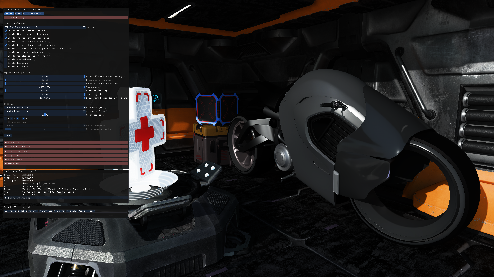

<!-- @page page_samples_denoiser AMD FSR™ Ray Regeneration -->

# AMD FSR™ Ray Regeneration Sample

This [sample](../../Samples/Denoisers/FidelityFX_Denoiser/dx12/FidelityFX_Denoiser_Sample_2022.sln) demonstrates how to integrate and experiment with AMD FSR™ Ray Regeneration 1.2.1, a real-time ray-tracing denoising solution designed to improve the stability and visual quality of ray-traced lighting signals.

For details on the underlying algorithm, refer to the [AMD FSR™ Ray Regeneration](../../Kits/FidelityFX/docs/techniques/denoising.md) technique documentation.

## Table of contents

- [1. Requirements](#1-requirements)
- [2. UI elements](#2-ui-elements)
  - [2.1. Provider](#21-provider)
  - [2.2. Context creation](#22-context-creation)
  - [2.3. Configure](#23-configure)
  - [2.4. Dispatch](#24-dispatch)
  - [2.5. Display](#25-display)
- [3. Setting up AMD FSR™ Ray Regeneration](#3-setting-up-amd-fsr-ray-regeneration)
- [4. Sample controls and configurations](#4-sample-controls-and-configurations)
- [5. See also](#5-see-also)

## 1. Requirements

- AMD FSR™ Ray Regeneration requires an AMD Radeon™ RX 9000 Series GPU or later.
- DirectX® 12 + Shader Model 6.6
- Windows® 11

> [!NOTE]
> AMD FSR™ Ray Regeneration is only supported on AMD Radeon™ RX 9000 Series GPUs or newer.
> On unsupported GPUs, the sample will still run, but denoising features will be disabled.

## 2. UI elements

The sample contains various UI elements to help you explore the techniques it demonstrates.
The tables below summarize the UI elements and what they control within the sample.

### 2.1. Provider

| **Element name** | **Values** | **Description** |
| -----------------|------------|-----------------|
| **Version** | `AMD FSR™ Ray Regeneration - 1.2.1` | Dropdown for specifying the provider.  Sets the corresponding [`versionId`](../../Kits/FidelityFX/api/include/ffx_api.h#L104) member of the [`ffxOverrideVersion`](../../Kits/FidelityFX/api/include/ffx_api.h#L101) description. |

### 2.2. Context creation

| **Element name** | **Values** | **Description** |
| -----------------|------------|-----------------|
| **Enable direct diffuse denoising** | Checked, Unchecked  | Checkbox for specifying whether the direct diffuse radiance should be denoised.  Toggles the [`FFX_DENOISER_SIGNAL_DIRECT_DIFFUSE`](../../Kits/FidelityFX/denoisers/include/ffx_denoiser.h#L601) flag to the [`signalFlags`](../../Kits/FidelityFX/denoisers/include/ffx_denoiser.h#L96) member of the [`ffxCreateContextDescDenoiser`](../../Kits/FidelityFX/denoisers/include/ffx_denoiser.h#L82) context creation description. |
| **Enable direct specular denoising** | Checked, Unchecked  | Checkbox for specifying whether the direct specular radiance should be denoised.  Toggles the [`FFX_DENOISER_SIGNAL_DIRECT_SPECULAR`](../../Kits/FidelityFX/denoisers/include/ffx_denoiser.h#L603) flag to the [`signalFlags`](../../Kits/FidelityFX/denoisers/include/ffx_denoiser.h#L96) member of the [`ffxCreateContextDescDenoiser`](../../Kits/FidelityFX/denoisers/include/ffx_denoiser.h#L82) context creation description. |
| **Enable indirect diffuse denoising** | Checked, Unchecked  | Checkbox for specifying whether the indirect diffuse radiance should be denoised.  Toggles the [`FFX_DENOISER_SIGNAL_INDIRECT_DIFFUSE`](../../Kits/FidelityFX/denoisers/include/ffx_denoiser.h#L607) flag to the [`signalFlags`](../../Kits/FidelityFX/denoisers/include/ffx_denoiser.h#L96) member of the [`ffxCreateContextDescDenoiser`](../../Kits/FidelityFX/denoisers/include/ffx_denoiser.h#L82) context creation description. |
| **Enable indirect specular denoising** | Checked, Unchecked  | Checkbox for specifying whether the indirect specular radiance should be denoised.  Toggles the [`FFX_DENOISER_SIGNAL_INDIRECT_SPECULAR`](../../Kits/FidelityFX/denoisers/include/ffx_denoiser.h#L609) flag to the [`signalFlags`](../../Kits/FidelityFX/denoisers/include/ffx_denoiser.h#L96) member of the [`ffxCreateContextDescDenoiser`](../../Kits/FidelityFX/denoisers/include/ffx_denoiser.h#L82) context creation description. |
| **Enable dominant light visibility denoising** | Checked, Unchecked  | Checkbox for specifying whether the dominant light visibility should be denoised.  Toggles the [`FFX_DENOISER_SIGNAL_DOMINANT_LIGHT_VISIBILITY`](../../Kits/FidelityFX/denoisers/include/ffx_denoiser.h#L605) flag to the [`signalFlags`](../../Kits/FidelityFX/denoisers/include/ffx_denoiser.h#L96) member of the [`ffxCreateContextDescDenoiser`](../../Kits/FidelityFX/denoisers/include/ffx_denoiser.h#L82) context creation description. |
| **Enable separate dominant light visibility denoising** | Checked, Unchecked  | Checkbox for specifying whether the dominant light visibility signal is denoised by its own dedicated context instead of the main one. Only available when dominant light visibility denoising is enabled.  When checked, the sample creates a second [`ffxCreateContextDescDenoiser`](../../Kits/FidelityFX/denoisers/include/ffx_denoiser.h#L82) context whose `signalFlags` contains only [`FFX_DENOISER_SIGNAL_DOMINANT_LIGHT_VISIBILITY`](../../Kits/FidelityFX/denoisers/include/ffx_denoiser.h#L605), and removes that flag from the main context. Both contexts receive the same [`ffxDispatchDescDenoiser`](../../Kits/FidelityFX/denoisers/include/ffx_denoiser.h#L167) frame parameters and are dispatched separately. This is exposition only, to demonstrate driving multiple denoiser contexts; in production the two dispatches can occur at different points in the frame. |
| **Enable ambient occlusion denoising** | Checked, Unchecked  | Checkbox for specifying whether the ambient occlusion should be denoised.  Toggles the [`FFX_DENOISER_SIGNAL_AMBIENT_OCCLUSION`](../../Kits/FidelityFX/denoisers/include/ffx_denoiser.h#L599) flag to the [`signalFlags`](../../Kits/FidelityFX/denoisers/include/ffx_denoiser.h#L96) member of the [`ffxCreateContextDescDenoiser`](../../Kits/FidelityFX/denoisers/include/ffx_denoiser.h#L82) context creation description. |
| **Enable specular occlusion denoising** | Checked, Unchecked  | Checkbox for specifying whether the specular occlusion should be denoised.  Toggles the [`FFX_DENOISER_SIGNAL_SPECULAR_OCCLUSION`](../../Kits/FidelityFX/denoisers/include/ffx_denoiser.h#L611) flag to the [`signalFlags`](../../Kits/FidelityFX/denoisers/include/ffx_denoiser.h#L96) member of the [`ffxCreateContextDescDenoiser`](../../Kits/FidelityFX/denoisers/include/ffx_denoiser.h#L82) context creation description. |
| **Enable checkerboarding** | Checked, Unchecked  | Checkbox for specifying whether the enabled signals are supplied in checkerboard (half-resolution) form for reconstruction.  When checked, the sample sets the [`checkerboardSignalFlags`](../../Kits/FidelityFX/denoisers/include/ffx_denoiser.h#L101) member of the [`ffxCreateContextDescDenoiser`](../../Kits/FidelityFX/denoisers/include/ffx_denoiser.h#L82) context creation description to the enabled signals, and sets the per-signal [`checkerboardOrigin`](../../Kits/FidelityFX/denoisers/include/ffx_denoiser.h#L160) each frame. |
| **Enable debugging** | Checked, Unchecked  | Checkbox for specifying whether debugging should be enabled.  Toggles the [`FFX_DENOISER_ENABLE_DEBUGGING`](../../Kits/FidelityFX/denoisers/include/ffx_denoiser.h#L557) flag to the [`flags`](../../Kits/FidelityFX/denoisers/include/ffx_denoiser.h#L104) member of the [`ffxCreateContextDescDenoiser`](../../Kits/FidelityFX/denoisers/include/ffx_denoiser.h#L82) context creation description. |
| **Enable validation** | Checked, Unchecked  | Checkbox for specifying whether exhaustive validation should be enabled.  Toggles the [`FFX_DENOISER_ENABLE_VALIDATION`](../../Kits/FidelityFX/denoisers/include/ffx_denoiser.h#L559) flag to the [`flags`](../../Kits/FidelityFX/denoisers/include/ffx_denoiser.h#L104) member of the [`ffxCreateContextDescDenoiser`](../../Kits/FidelityFX/denoisers/include/ffx_denoiser.h#L82) context creation description. |

### 2.3. Configure

| **Element name** | **Values** | **Description** |
| -----------------|------------|-----------------|
| **Cross bilateral normal strength** | [0.0, 1.0] | Sets the [`FFX_API_CONFIGURE_DENOISER_KEY_CROSS_BILATERAL_NORMAL_STRENGTH`](../../Kits/FidelityFX/denoisers/include/ffx_denoiser.h#L566) configuration parameter. |
| **Disocclusion threshold** | [0.01, 0.05] | Sets the [`FFX_API_CONFIGURE_DENOISER_KEY_DISOCCLUSION_THRESHOLD`](../../Kits/FidelityFX/denoisers/include/ffx_denoiser.h#L581) configuration parameter. |
| **Gaussian kernel relaxation** | [0.0, 1.0] | Sets the [`FFX_API_CONFIGURE_DENOISER_KEY_GAUSSIAN_KERNEL_RELAXATION`](../../Kits/FidelityFX/denoisers/include/ffx_denoiser.h#L578) configuration parameter. |
| **Max radiance** | [0.0, 65504.0] | Sets the [`FFX_API_CONFIGURE_DENOISER_KEY_MAX_RADIANCE`](../../Kits/FidelityFX/denoisers/include/ffx_denoiser.h#L572) configuration parameter. |
| **Radiance std clip** | [0.0, 65504.0] | Sets the [`FFX_API_CONFIGURE_DENOISER_KEY_RADIANCE_CLIP_STD_K`](../../Kits/FidelityFX/denoisers/include/ffx_denoiser.h#L575) configuration parameter. |
| **Stability bias** | [0.0, 1.0] | Sets the [`FFX_API_CONFIGURE_DENOISER_KEY_STABILITY_BIAS`](../../Kits/FidelityFX/denoisers/include/ffx_denoiser.h#L569) configuration parameter. |
| **Debug view linear depth max bound** | [0.001, 1024.0] | Sets the `max` field of the [`FFX_API_CONFIGURE_DENOISER_KEY_DEBUG_VIEW_LINEAR_DEPTH_BOUNDS`](../../Kits/FidelityFX/denoisers/include/ffx_denoiser.h#L584) configuration parameter. Only the max bound is exposed in the sample UI; the min bound is set programmatically. |

### 2.4. Dispatch

| **Element name** | **Values** | **Description** |
| -----------------|------------|-----------------|
| **Reset** | NA | Button for resetting the history accumulation.  Toggles the [`FFX_DENOISER_DISPATCH_RESET`](../../Kits/FidelityFX/denoisers/include/ffx_denoiser.h#L617) flag to the [`flags`](../../Kits/FidelityFX/denoisers/include/ffx_denoiser.h#L320) member of the [`ffxDispatchDescDenoiser`](../../Kits/FidelityFX/denoisers/include/ffx_denoiser.h#L167) dispatch description. |

### 2.5. Display

| **Element name** | **Values** | **Description** |
| -----------------|------------|-----------------|
| **View mode (left)** | Denoised Composited, Denoised Composited - Direct, Denoised Composited - Direct Diffuse, Denoised Composited - Direct Specular, Denoised Composited - Indirect, Denoised Composited - Indirect Diffuse, Denoised Composited - Indirect Specular, Denoised Composited - Dominant Light Visibility, Denoised Signal - Direct Diffuse, Denoised Signal - Direct Specular, Denoised Signal - Indirect Diffuse, Denoised Signal - Indirect Specular, Denoised Signal - Dominant Light Visibility, Denoised Signal - Ambient Occlusion, Denoised Signal - Specular Occlusion, Noisy Composited, Noisy Composited - Direct, Noisy Composited - Direct Diffuse, Noisy Composited - Direct Specular, Noisy Composited - Indirect, Noisy Composited - Indirect Diffuse, Noisy Composited - Indirect Specular, Noisy Composited - Dominant Light Visibility, Noisy Signal - Direct Diffuse, Noisy Signal - Direct Specular, Noisy Signal - Indirect Diffuse, Noisy Signal - Indirect Specular, Noisy Signal - Dominant Light Visibility, Noisy Signal - Ambient Occlusion, Noisy Signal - Specular Occlusion, Skip, Diffuse Albedo, Specular Albedo, Roughness, Linear Depth, Linear Depth Delta, Motion Vectors, Normals | Dropdown for specifying the view mode to display. When **View mode (right)** differs from this, it is shown on the left side of the split comparison; otherwise it fills the screen. |
| **View mode (right)** | Denoised Composited, Denoised Composited - Direct, Denoised Composited - Direct Diffuse, Denoised Composited - Direct Specular, Denoised Composited - Indirect, Denoised Composited - Indirect Diffuse, Denoised Composited - Indirect Specular, Denoised Composited - Dominant Light Visibility, Denoised Signal - Direct Diffuse, Denoised Signal - Direct Specular, Denoised Signal - Indirect Diffuse, Denoised Signal - Indirect Specular, Denoised Signal - Dominant Light Visibility, Denoised Signal - Ambient Occlusion, Denoised Signal - Specular Occlusion, Noisy Composited, Noisy Composited - Direct, Noisy Composited - Direct Diffuse, Noisy Composited - Direct Specular, Noisy Composited - Indirect, Noisy Composited - Indirect Diffuse, Noisy Composited - Indirect Specular, Noisy Composited - Dominant Light Visibility, Noisy Signal - Direct Diffuse, Noisy Signal - Direct Specular, Noisy Signal - Indirect Diffuse, Noisy Signal - Indirect Specular, Noisy Signal - Dominant Light Visibility, Noisy Signal - Ambient Occlusion, Noisy Signal - Specular Occlusion, Skip, Diffuse Albedo, Specular Albedo, Roughness, Linear Depth, Linear Depth Delta, Motion Vectors, Normals | Dropdown for specifying the view mode shown on the right side of the split comparison. When it differs from **View mode (left)**, the screen is split by a magenta vertical divider at **Split position** (left mode on the left, right mode on the right); when equal, no split is drawn. |
| **Split position** | [0.0, 1.0] | Slider for specifying the horizontal position of the split divider, as a fraction of the render width from the left edge. Only has an effect when **View mode (left)** and **View mode (right)** differ. |
| ${\color{red}R}$ ${\color{green}G}$ ${\color{blue}B}$ ${\color{white}A}$ | Checked, Unchecked  | Checkboxes for specifying which color channels (i.e. ${\color{red}red}$, ${\color{green}green}$, ${\color{blue}blue}$, ${\color{white}alpha}$) of the selected view mode should be displayed. |
| **Show debug view** | Checked, Unchecked  | Checkbox for specifying whether the debug view should be dispatched and drawn. The debug view requires debugging to be enabled.
| **Debug view mode** | Overview, Fullscreen Target  | Dropdown for specifying the debug view mode to display.  Sets the corresponding [`mode`](../../Kits/FidelityFX/denoisers/include/ffx_denoiser.h#L347) member of the [`ffxDispatchDescDenoiserDebugView`](../../Kits/FidelityFX/denoisers/include/ffx_denoiser.h#L330) dispatch description.
| **Debug viewport index** | [0,`FFX_API_DENOISER_DEBUG_VIEW_MAX_VIEWPORTS`) | Slider for specifying the debug viewport index for the Fullscreen Target debug view mode.  Sets the corresponding [`viewportIndex`](../../Kits/FidelityFX/denoisers/include/ffx_denoiser.h#L351) member of the [`ffxDispatchDescDenoiserDebugView`](../../Kits/FidelityFX/denoisers/include/ffx_denoiser.h#L330) dispatch description.

> [!NOTE]
> The split comparison operates on the render-resolution signals, before upscaling. For an accurate side-by-side comparison, ideally no upscaler should be used (i.e. fullscreen denoising at native resolution), so that both sides are shown without upscaling artifacts influencing the result.

> [!NOTE]
> The noisy composition and signal view modes (**Noisy Composited…** and **Noisy Signal…**) are unavailable when **Enable checkerboarding** is active, because AMD FSR™ Upscaling cannot mix checkerboarded and non-checkerboarded input textures. Selecting one while checkerboarding is enabled falls back to **Denoised Composited** and logs a warning.

## 3. Setting up AMD FSR™ Ray Regeneration

The sample includes a [dedicated Render Module for AMD FSR™ Ray Regeneration](../../Samples/Denoisers/FidelityFX_Denoiser/dx12/denoiserrendermodule.h) which creates the context and manages its lifetime. See the [AMD FSR™ Ray Regeneration](../../Kits/FidelityFX/docs/techniques/denoising.md) technique documentation for more details.

## 4. Sample controls and configurations

For information on sample controls, configuration options, and Cauldron Framework UI elements, see [Running the samples](../getting-started/running-samples.md).

## 5. See also

- [AMD FSR™ Ray Regeneration API](../../Kits/FidelityFX/denoisers/include/ffx_denoiser.h)
- [AMD FSR™ Ray Regeneration technique documentation](../../Kits/FidelityFX/docs/techniques/denoising.md)