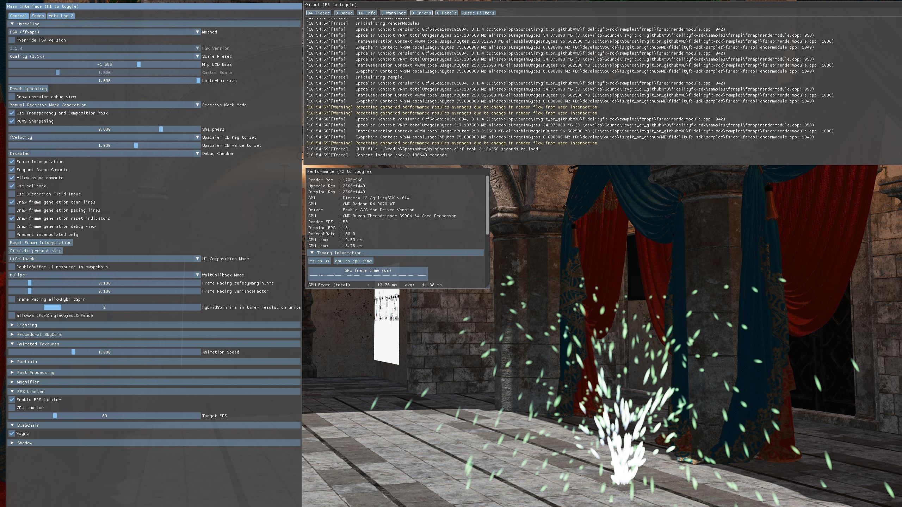
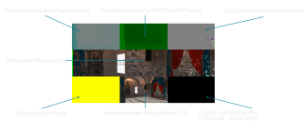

<!-- @page page_samples_super-resolution AMD FSR™ -->

<h1>AMD FSR™ Upscaling and Frame Generation Sample</h1>

This sample demonstrates the use of AMD FSR™ Upscaling 4.1.2 (and 3.1.6 & 2.3.4) for upscaling and AMD FSR™ Frame Generation 4.0.2 (and 3.1.6).

For details on the underlying algorithms you can refer to the per-technique documentation for [AMD FSR™ Upscaling 4](../../Kits/FidelityFX/docs/techniques/super-resolution-ml.md) and [AMD FSR™ Frame Generation 4](../../Kits/FidelityFX/docs/techniques/frame-interpolation-ml.md).

<h2>Requirements</h2>

 - Windows
 - DirectX® 12 (Agility SDK 1.616.1)
 - Vulkan® 1.2

<h2>UI elements</h2>

The sample contains various UI elements to help you explore the techniques it demonstrates. The table below summarises the UI elements and what they control within the sample.

| Element name | Value | Description |
| -------------|-------|-------------|
| **Particle animation** | `Checked, Unchecked` | Enables or disables particle emission which is used to demonstrate the use of the Reactive mask. |
| **Method** | `Native, FSR` | Used to select the method of upscaling, either native resolution with no upscaling or upscaling using FSR. |
| **Override version** | `Checked, Unchecked` | Toggles whether the sample pins the upscaler to the version selected below. When unchecked, the AMD FSR™ API selects the newest available version automatically, which may be a version provided by the driver. |
| **AMD FSR™ Version** | `4.1.2`, `3.1.6`, `2.3.4` | Select the AMD FSR™ upscaler version to use. The list is populated by a version query, so the entries available depend on the installed driver. Versions provided by the driver are marked with a trailing `*`. Only applied when **Override version** is checked. |
| **Scale Preset** | `Native AA (1.0x), Quality (1.5x), Balanced (1.7x), Performance (2x), Ultra Performance (3x), Custom` | Select upscaling preset which represents the scaling factor per dimension from render resolution to display resolution. |
| **Mip LOD Bias** | `-5.0..0.0` | Used for choosing the amount of mipmap biasing applied for sampling textures during the G-Buffer pass.  |
| **Custom Scale** | `1.0..3.0` | Allows you to set a custom scaling factor when Scale Preset is set to 'Custom'. |
| **Letterbox size** | `0.2..1.0` | Adds a black border around the frame when set to values below 1. |
| **Reset Upscaling** |  | When clicked, sets the upscaling reset flag for one frame, simulating a discontinuous camera change. |
| **Draw upscaler debug view** | `Checked, Unchecked` | Toggles upscaler debug view. See the explanation below. |
| **Reactive Mask Mode** | `Disabled, Manual Reactive Mask Generation, Autogen FSR2 Helper Function` | Used to select the method of generating the Reactive mask. Either disables it completely, generates it manually by drawing transparent objects or generates it automatically using the helper function provided by AMD FidelityFX™ Super Resolution 2. |
| **Use Transparency and Composition Mask** | `Checked, Unchecked` | Toggles the use of the Transparency and Composition Mask. |
| **RCAS Sharpening** | `Checked, Unchecked` | Toggles the use of RCAS sharpening. |
| **Sharpness** | `0.0..1.0` | Changes the amount of sharpening applied if RCAS is enabled. |
| **Upscaler CB Key** | `fVelocity, fReactivenessScale, fShadingChangeScale, fAccumulationAddedPerFrame, fMinDisocclusionAccumulation` | Select the upscaler tuning knob exposed in KeyValue API|
| **Upscaler CB Value** | `-1.0..2.0` | Calls KeyValue API to set upscaler tuning knob with this value when changed|
| **Debug Checker** | `Disabled`, `Enabled. Set nullptr message callback`, `Enabled. Set Cauldron message callback` | Select between debug checker behaviors for all ffx-api contexts. Whether debug checker is disabled, enabled and output message to debugger TTY, or enabled and output message to application's callback. Will recreate context when flag bit FFX_FSR3UPSCALER_ENABLE_DEBUG_CHECKING or FFX_FRAMEGENERATION_ENABLE_DEBUG_CHECKING changes. |
| **Frame Interpolation** | `Checked, Unchecked` | Toggles frame generation. |
| **Support Async Compute** | `Checked, Unchecked` | Toggles async compute flag set during context creation. |
| **Allow async compute** | `Checked, Unchecked` | Toggles use of async compute queue. |
| **Use callback** | `Checked, Unchecked` | Toggles use of frame generation callback. |
| **Use Distortion Field Input** | `Checked, Unchecked` | Toggles use of `distortionField` texture. |
| **Draw frame generation tear lines** | `Checked, Unchecked` | Toggles tearing indicators on the left and right sides of the window. |
| **Draw frame generation pacing lines** | `Checked, Unchecked` | Toggles 2 vertical lines on the left of the window. Leftmost line alternates between green & magenta. The other line alternates between black & white. If the pacing is done properly, the user should see two grey lines. |
| **Draw frame generation reset indicators** | `Checked, Unchecked` | Toggles reset indicators at the top side of the window. |
| **Draw frame generation debug view** | `Checked, Unchecked` | Toggles frame generation debug view. See the explanation below. |
| **Present interpolated only** | `Checked, Unchecked` | When enabled, only interpolated frames are shown. |
| **Reset Frame Interpolation** | | When clicked, sets the frame generation reset flag for one frame, simulating a discontinuous camera change. |
| **Simulate present skip** | | When clicked, simulates skipping presentation of one frame by incrementing the frame ID by two. |
| **UI Composition mode** | `No UI handling (not recommended), UiTexture, UiCallback, Pre-Ui Backbuffer` | Select method for rendering the user interface for generated frames. |
| **DoubleBuffer UI resource in swapchain** | `Checked, Unchecked` | Toggles double-buffering of UI resource in the swapchain context. |
| **Waitcallback Mode** | `nullptr, CAULDRON_LOG_DEBUG(waitCallback)` | If enabled, frame interpolation swapchain will call waitcallback at select places. For example, when resize window takes longer than 1ms. |
| **Frame Pacing safetyMarginInMs** | `0.0..1.0` | Changes frame interpolation swapchain pacing tuning `safetyMarginInMs` value. |
| **Frame Pacing varianceFactor** | `0.0..1.0` | Changes frame interpolation swapchain pacing tuning `varianceFactor` value. |
| **Frame Pacing allowHybridSpin** | `Checked, Unchecked` | Toggles whether frame interpolation swapchain presenterthread will hybrid spin instead of busy spin when waiting for target QPC of before present the frame. |
| **Frame Pacing hybridSpinTime in timer resolution units** | `0.0..10.0` | Changes interpolation swapchain presenterthread sleep amount between checking if reached target QPC of completed frame. |
| **Frame Pacing allowWaitForSingleObjectOnFence** | `Checked, Unchecked` | Toggles whether frame interpolation swapchain interpolationThread will use WaitForSingleObject instead of busy spin waiting for interpolationFence |

<h3>Upscaler debug view</h3>

When the upscaler debug view is enabled, the following will be shown:

<h3>Frame generation debug view and markers</h3>

When the frame generation debug view is enabled, the following will be shown:

In addition to the debug view, several markers can be enabled that may appear at the sides and top of the window.

If tear lines are enabled, a green bar will be drawn on the left of every generated frame and a color changing bar on the right of every generated frame. This will assist in visualizing if interpolated frames are getting presented and if the frames are presented with tearing enabled.

If reset indicators are enabled, a red bar will appear at the top of the screen if frame generation is manually reset and a blue bar if the optical flow algorithm detects a discontinuous camera change.

<h2>Setting up AMD FSR™ Upscaling</h2>

The sample contains a [dedicated Render Module for AMD FSR™](../../Samples/Upscalers/FidelityFX_FSR/internal/fsrapirendermodule.h) which creates the contexts and controls their lifetime. See the AMD FSR™ Upscaling Overview and Integration document for more information.

<h2>Sample controls and configurations</h2>

For sample controls, configuration, and Cauldron Framework UI element details, see [Running the samples](../getting-started/running-samples.md).

<h2>See also</h2>

- [AMD FSR™ Upscaling 4](../../Kits/FidelityFX/docs/techniques/super-resolution-ml.md)
- [AMD FSR™ Frame Generation 4](../../Kits/FidelityFX/docs/techniques/frame-interpolation-ml.md)
